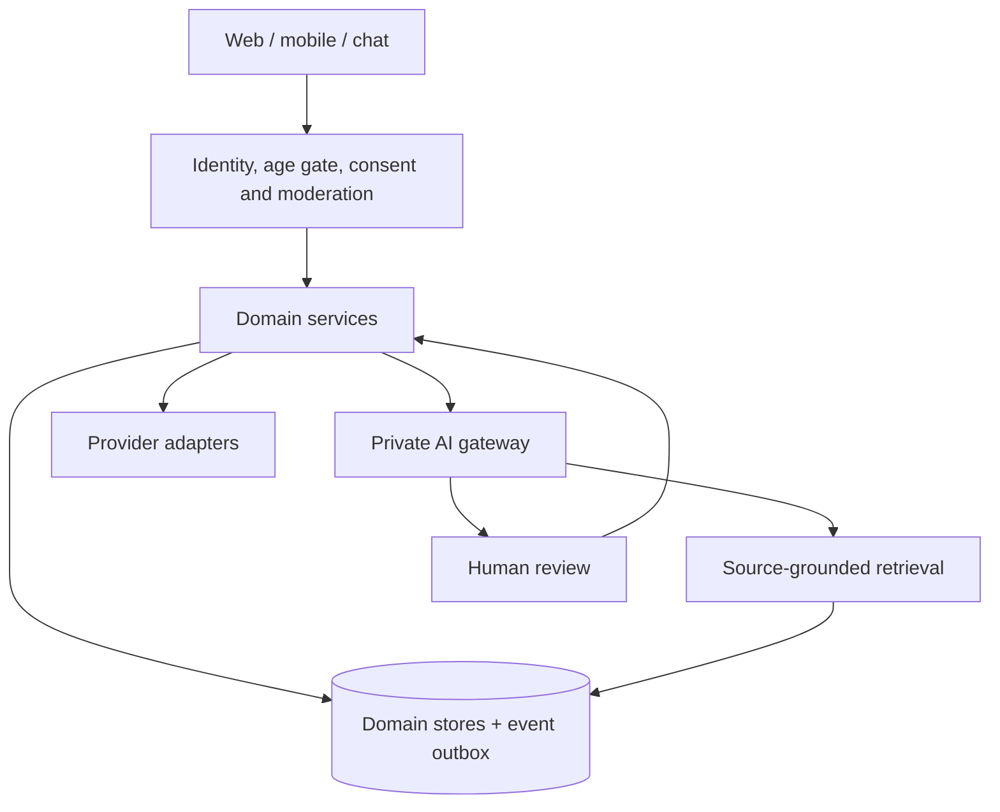

# JFXAI4MAD — GraalFlectra / Odoo, AI Coordination and OpenTwin MBSE

**Status:** proposed reference architecture, product model and research workspace.

JFXAI4MAD is a modular open-source concept that combines an Odoo/Flectra-derived enterprise platform, GraalPy/GraalVM migration research, private AI integration, destination-travel and LegalTech coordination, professional collaboration, adult-only social discovery, and MBSE/OpenTwin design studies.

The repository currently contains documentation, research notes, concept images and requirements diagrams. Proposed services, integrations, partnerships, budgets and performance figures are planning material unless explicitly documented as implemented or externally verified.

## Documentation map

The root README is intentionally concise. Detailed material is organized by domain under `docs/`.

| Area | Primary document | Purpose |
| --- | --- | --- |
| Architecture | [Odoo/Flectra → GraalPy migration](docs/architecture/odoo-graalpy-migration.md) | Runtime compatibility, C extensions, concurrency, polyglot services and migration gates |
| Architecture | [KVM demo sandbox hosting](docs/architecture/kvm-hosting-ephemeral-demo-sandbox.md) | VPS sizing, session lifecycle, provider terms and benchmark gates |
| Architecture | [Local Docker demo workflow](docs/architecture/github-docker-local-demo-workflow.md) | GitHub checkout, Compose/Dockerfile startup, development sync and local safeguards |
| Architecture | [Platform integration and AI](docs/architecture/platform-integration-ai.md) | Domain services, private AI gateway, retrieval, human review and provider adapters |


## Architecture overview

The proposed platform separates identity/consent, domain services, AI processing, provider adapters and auditable persistence.



The ERP/runtime track is documented separately so that GraalPy migration risk does not obscure the product architecture. See [Odoo/Flectra → GraalPy migration](docs/architecture/odoo-graalpy-migration.md).

## Odoo/Flectra and GraalPy track

The project evaluates an Odoo/Flectra-derived ERP runtime on GraalPy/GraalVM. The objective is not to assume automatic performance gains, but to test compatibility and identify where polyglot or native workers are justified.

The migration plan covers:

1. dependency audit;
2. GraalPy runtime prototype;
3. C-extension adaptation;
4. ORM and concurrency validation;
5. selected polyglot integrations;
6. performance/security testing; and
7. staging/rollback rehearsal.

Detailed compatibility and acceptance criteria are maintained in [`docs/architecture/odoo-graalpy-migration.md`](docs/architecture/odoo-graalpy-migration.md). The companion architecture diagram remains at [`MBSE/CAS/drawio/odoo-graalpy-migration.drawio`](MBSE/CAS/drawio/odoo-graalpy-migration.drawio).

## MBSE and OpenTwin

The repository includes concept renderings and requirements diagrams under `MBSE/`.

- [OpenTwin modular habitat and shared-retreat work package](docs/mbse/opentwin-modular-habitat.md)
- [CAD concepts](MBSE/CAD/)
- [Requirements and architecture diagrams](MBSE/CAS/drawio/)

The visual assets are conceptual engineering studies; dimensions, structures, access, utilities and simulation claims require model reconciliation and verification.

## Repository layout

```text
.
├── README.md
├── docs/
│   ├── architecture/
│   │   ├── odoo-graalpy-migration.md
│   │   └── platform-integration-ai.md
│   ├── mbse/
│   │   └── opentwin-modular-habitat.md
│   ├── README.md
└── MBSE/
    ├── CAD/
    └── CAS/drawio/
```

**Positioning:** JFXAI4MAD is an evidence-led modular architecture and research project for ERP modernization, AI-assisted coordination, destination/LegalTech services, professional collaboration and OpenTwin/MBSE studies, with explicit user choice and human accountability at its core.
