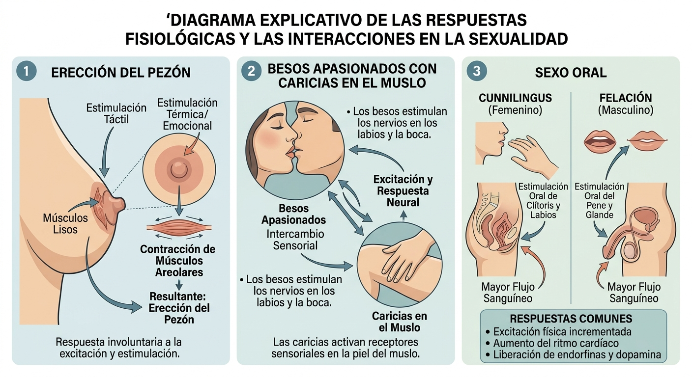
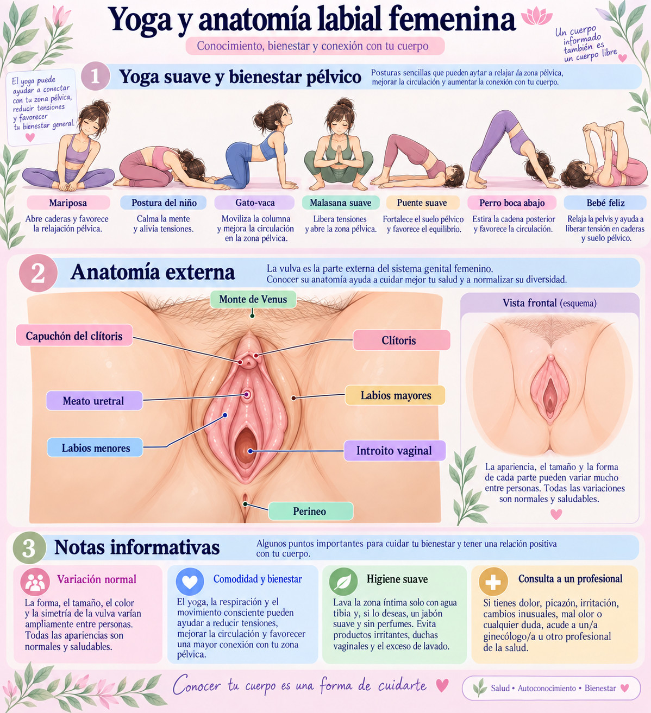

# Consolidated Documentation Annex

**Repository:** `robotics-intelligent-systems/jfxai4mad`  
**Scope:** indexed documentation annex for the English `docs/*.md` sources and supporting `docs/*.jpg` infographics  
**Editorial revision:** 17 October 2026

> **Editorial status.** Seventy plaintext source entries processed to date have been migrated to structured English Markdown documents with standardized English filenames. Numerical, legal, medical, demographic, platform-specific, prevalence, institutional-interest, child-protection and market-price claims inherited from legacy notes remain subject to current-source verification before publication or operational use.

## Contents

- [53. Aeronautical academy outreach and community funnel](#53-aeronautical-academy-outreach-and-community-funnel)
- [54. GitHub open-source B2B market sizing and ROI](#54-github-open-source-b2b-market-sizing-and-roi)
- [52. Online-marriage market distribution scenario](#52-online-marriage-market-distribution-scenario)
- [50. Male strength-athlete nutrition and hormones over 40](#50-male-strength-athlete-nutrition-and-hormones-over-40)
- [49. Local Docker demo workflow](#49-local-docker-demo-workflow)
- [45. Country workforce profiles for women in STEM](#45-country-workforce-profiles-for-women-in-stem)
- [44. Women in the STEM education-to-career pipeline](#44-women-in-the-stem-education-to-career-pipeline)

- [41. Italy logistics and cultural node](#41-italy-logistics-and-cultural-node)

- [40. KVM hosting for ephemeral demo sandboxes](#40-kvm-hosting-for-ephemeral-demo-sandboxes)
- [39. Interactive demo and B2B conversion](#39-interactive-demo-and-b2b-conversion)

- [38. Barranco residential training hub](#38-barranco-residential-training-hub)

- [37. TravelGirls and Worldpackers volunteer collaboration](#37-travelgirls-and-worldpackers-volunteer-collaboration)

- [36. Open-minded destinations and group hospitality](#36-open-minded-destinations-and-group-hospitality)

- [34. LinkedIn contact acquisition and lead velocity](#34-linkedin-contact-acquisition-and-lead-velocity)

- [33. Ten skilled jobs: payroll and B2B conversion](#33-ten-skilled-jobs-payroll-and-b2b-conversion)
- [32. Value architecture, financing and sustainable logistics](#32-value-architecture-financing-and-sustainable-logistics)

- [31. Ergonomic recliners and support wedges](#31-ergonomic-recliners-and-support-wedges)

- [30. Female athlete anthropometry](#30-female-athlete-anthropometry)
- [29. UAE age-13 family law and child travel](#29-uae-age-13-family-law-and-child-travel)
- [28. Tucumán Carnival and Medellín cultural festivals](#28-tucumán-carnival-and-medellín-cultural-festivals)

- [27. Natality model and age-13 legal/platform framework](#27-natality-model-and-age-13-legalplatform-framework)

- [26. Djibouti child-marriage source review](#26-djibouti-child-marriage-source-review)

- [25. Lima–Rio flight and five-night stay](#25-limario-flight-and-five-night-stay)

- [24. Lima–Rio bus travel and Carnival planning](#24-limario-bus-travel-and-carnival-planning)

- [23. Rio Carnival calendar](#23-rio-carnival-calendar)

- [1. Documentation migration and normalization](#1-documentation-migration-and-normalization)
- [2. Tourism and international mobility](#2-tourism-and-international-mobility)
- [3. Destination weddings, collaboration and professional development](#3-destination-weddings-collaboration-and-professional-development)
- [4. Legal hospitality, entertainment and cost planning](#4-legal-hospitality-entertainment-and-cost-planning)
- [5. Platforms, audiences and market-analysis notes](#5-platforms-audiences-and-market-analysis-notes)
- [6. Adult relationships, consent and sexual-health education](#6-adult-relationships-consent-and-sexual-health-education)
- [7. Scheduling and Lima activity planning](#7-scheduling-and-lima-activity-planning)
- [8. Sex work, student welfare, demography and legal context](#8-sex-work-student-welfare-demography-and-legal-context)
- [9. Infographic catalog](#9-infographic-catalog)
- [10. Complete migration and translation register](#10-complete-migration-and-translation-register)
- [11. Additional strategy and tourism consolidation](#11-additional-strategy-and-tourism-consolidation)

- [12. Residential and cooperative settlement concepts](#12-residential-and-cooperative-settlement-concepts)

- [13. Marriage-conversion platform research](#13-marriage-conversion-platform-research)
- [14. Sport fishing and hunting tourism](#14-sport-fishing-and-hunting-tourism)
- [15. Colombian emigration destinations](#15-colombian-emigration-destinations)
- [16. Uruguay, Paraguay and Bolivia tourism flows](#16-uruguay-paraguay-and-bolivia-tourism-flows)
- [17. Peru–Paraguay air and overland routes](#17-peruparaguay-air-and-overland-routes)
- [18. Peru–Brazil and Brazil–Paraguay integration corridors](#18-perubrazil-and-brazilparaguay-integration-corridors)
- [19. Multisector territorial tourism development flow](#19-multisector-territorial-tourism-development-flow)

---

- [20. Additional tourism policy, demographic and security concepts](#20-additional-tourism-policy-demographic-and-security-concepts)
- [21. Marriage in Djibouti for foreign nationals](#21-marriage-in-djibouti-for-foreign-nationals)
- [22. French Guiana access and dual-nationality entry research](#22-french-guiana-access-and-dual-nationality-entry-research)

## 1. Documentation migration and normalization

The migration applies a consistent editorial policy across the `docs/` directory:

- English filenames and English prose;
- Markdown heading hierarchy, tables and lists;
- Mermaid diagrams where process visualization improves clarity;
- relative links to repository-local documents and image assets;
- explicit separation between inherited claims and verified facts;
- separation of professional, legal, medical, adult-relationship, safeguarding and public-policy topics;
- explicit distinction between consensual adult sex work and trafficking, coercion, exploitation or sexual violence;
- explicit separation of child sexual exploitation from all adult sex-work analysis;
- no operational guidance for evading platform moderation, targeting individuals for compensated sexual arrangements or facilitating exploitation.

The two JPG assets remain in image format and retain standardized English filenames.

---

## 2. Tourism and international mobility

- [Peru–Brazil and Brazil–Paraguay integration corridors](./research/tourism/peru-brazil-paraguay-integration-corridors.md) — comparative infrastructure, traffic, air-service claims and economic themes.

- [Peru–Paraguay air and overland routes](./research/tourism/peru-paraguay-air-and-overland-routes.md) — route alternatives, geographic corrections and selected entry/health source checks.

- [`us-tourism-and-international-marriage-notes.md`](./us-tourism-and-international-marriage-notes.md) — U.S. tourism destinations, origin markets and a separately qualified legacy section on international-marriage agencies and K-1 fiancé(e) visas.
- [`peru-colombia-inbound-tourism-comparison.md`](./peru-colombia-inbound-tourism-comparison.md) — side-by-side comparison of inbound tourism patterns in Peru and Colombia.
- [`argentina-inbound-tourism-origin-markets.md`](./argentina-inbound-tourism-origin-markets.md) — structured summary of Argentina's origin markets and regional travel flows.
- [`international-dating-agencies-and-latam-remote-work.md`](./international-dating-agencies-and-latam-remote-work.md) — refactored mixed source separating historical international-dating-agency context from Latin American remote-work analysis.

All tourism totals, market shares, immigration figures and legal statements require current-source validation before external use.

---

## 3. Destination weddings, collaboration and professional development

- [`destination-wedding-academic-partnership-roadmap.md`](./destination-wedding-academic-partnership-roadmap.md) — six-month academic-industry roadmap for destination-wedding and tourism collaboration, with unsupported probability claims replaced by planning-priority bands and measurable KPIs.
- [`interuniversity-rural-development-collaboration-framework.md`](./interuniversity-rural-development-collaboration-framework.md) — proposed UNAL–UNCUYO–UGR collaboration framework.
- [`multipurpose-project-interest-survey.md`](./multipurpose-project-interest-survey.md) — structured project-interest and collaboration survey.
- [`mutual-upskilling-and-talent-flow-strategy.md`](./mutual-upskilling-and-talent-flow-strategy.md) — bidirectional talent-development and metropolitan hub strategy.
- [`ai-cloud-sales-curriculum.md`](./ai-cloud-sales-curriculum.md) — twelve-week AI-assisted cloud-sales curriculum.
- [`compatibility-platform-collaboration-concept.md`](./compatibility-platform-collaboration-concept.md) — concept separating social/relationship-platform use from professional collaboration.

---

## 4. Legal hospitality, entertainment and cost planning

### 4.1 Legal hospitality and entertainment service cost model

[`legal-hospitality-entertainment-service-cost-model.md`](./legal-hospitality-entertainment-service-cost-model.md)

This document translates and refactors the legal-service planning note into a professional pricing model for **non-sexual** hospitality, protocol, wellness, entertainment and concierge services.

It includes preliminary planning ranges, standardized billing units, measurable cost drivers, an itemized quotation formula, optional surcharges, procurement rules and a four-stage progress plan. The ranges remain budgeting hypotheses rather than verified supplier quotations and must be refreshed before commercial deployment.

---

## 5. Platforms, audiences and market-analysis notes

- [`ukraine-conversion-collaboration-and-income-analysis.md`](./ukraine-conversion-collaboration-and-income-analysis.md) — separates professional-network use from dating-platform activity and marks inherited conversion estimates as unverified.
- [`linkedin-regional-user-estimates.md`](./linkedin-regional-user-estimates.md) — regional membership estimates with methodological qualifications.
- [`linkedin-marital-status-inference.md`](./linkedin-marital-status-inference.md) — explains why general demographic rates must not be converted into individual relationship-status attributes.
- [`europe-linkedin-unemployment-comparison.md`](./europe-linkedin-unemployment-comparison.md) — comparative platform-size and labor-market note.
- [`okcupid-regional-sociocultural-comparison.md`](./okcupid-regional-sociocultural-comparison.md) — exploratory regional comparison with cultural observations treated as hypotheses.
- [`regional-linkedin-unemployment-comparison.md`](./regional-linkedin-unemployment-comparison.md) — regional membership/unemployment comparison with methodological warnings.

---

## 6. Adult relationships, consent and sexual-health education

- [`ethical-non-monogamy-quarterly-reviews.md`](./ethical-non-monogamy-quarterly-reviews.md) — adult consensual relationship framework based on explicit agreements and renewable reviews.
- [`adult-interaction-consent-and-sexual-health.md`](./adult-interaction-consent-and-sexual-health.md) — educational material covering adult-only consent, communication, sexual health and comfort.
- [`public-space-sexual-behavior-mass-festivals.md`](./public-space-sexual-behavior-mass-festivals.md) — public-policy analysis of adult sexual behavior in mass-festival settings.

---

## 7. Scheduling and Lima activity planning

- [`forms-calendar-meet-workflow.md`](./forms-calendar-meet-workflow.md) — Forms → scheduler → Calendar → Meet workflow with data-minimization guidance.
- [`lima-public-spaces-and-libraries.md`](./lima-public-spaces-and-libraries.md) — structured local activity and library notes with instructions to verify current access conditions.

---

## 8. Sex work, student welfare, demography and legal context

- [`metropolitan-sex-work-distribution-and-legal-frameworks.md`](./metropolitan-sex-work-distribution-and-legal-frameworks.md) — comparative review of selected metropolitan estimates and broad regulatory models.
- [`intersectional-demographic-analysis-sex-work.md`](./intersectional-demographic-analysis-sex-work.md) — analysis of socioeconomic, housing, care, migration and demographic variables without treating them as predictors of individual conduct.
- [`student-sex-work-and-sugar-dating-regional-analysis.md`](./student-sex-work-and-sugar-dating-regional-analysis.md) — regional socioeconomic and student-welfare analysis across North America, Europe and Latin America.
- [`university-sex-work-estimates-and-platform-integrity.md`](./university-sex-work-estimates-and-platform-integrity.md) — Latin American prevalence hypotheses and platform-integrity discussion; coded solicitation material is not reproduced operationally.
- [`informal-sexual-services-pricing-research-note.md`](./informal-sexual-services-pricing-research-note.md) — refactored research note preserving structural market variables while removing operational price guidance for sexual acts.
- [`philippines-turkiye-mexico-sex-work-comparative-analysis.md`](./philippines-turkiye-mexico-sex-work-comparative-analysis.md) — translated and refactored comparison of the Philippines, Türkiye and Mexico covering inherited legal-framework descriptions, prevalence claims, socioeconomic context and safeguarding risks.
- [`india-sex-work-legal-socioeconomic-case-analysis.md`](./india-sex-work-legal-socioeconomic-case-analysis.md) — translated and refactored India case analysis covering the inherited ITPA description, the referenced 2022 Supreme Court dignity/protection framework, broad prevalence estimates, urban case studies, socioeconomic vulnerability and trafficking distinctions.
- [`israel-sex-work-legal-socioeconomic-case-analysis.md`](./israel-sex-work-legal-socioeconomic-case-analysis.md) — translated and refactored Israel case analysis, including a demand-side prohibition framework, enforcement references, historical prevalence estimates and trafficking distinctions.
- [`thailand-sex-work-tourism-trafficking-analysis.md`](./thailand-sex-work-tourism-trafficking-analysis.md) — translated and refactored Thailand case covering the inherited prohibition framework, entertainment economy, tourism, regional migration, socioeconomic vulnerability and trafficking distinctions. Legacy prevalence figures and reform claims remain explicitly unverified.
- [`arabian-peninsula-gulf-sex-work-trafficking-child-protection-analysis.md`](./arabian-peninsula-gulf-sex-work-trafficking-child-protection-analysis.md) — translated and refactored comparison of the UAE, Qatar and Yemen. It separates criminal-law, migrant-labor, trafficking, humanitarian and child-protection questions, and avoids treating the Arabian Peninsula as a single homogeneous legal or socioeconomic system.

### 8.1 Editorial safeguards for adult-focused analysis

Across the adult-focused material:

- consensual adult sex work is not conflated with trafficking or coercion;
- no person should be profiled as a sex worker or trafficking victim based on age, appearance, university, occupation, income, nationality, ethnicity, caste, religion, migration status, gender identity or online-profile language;
- prevalence and price estimates require identifiable source populations, dates, definitions and sampling methods;
- national legal summaries must be verified separately from local enforcement or municipal rules;
- court decisions, temporary legislation and constitutional-rights claims must be checked against authoritative texts and later legal developments;
- enforcement counts should not be used as direct prevalence estimates;
- professional platforms should not be used to conceal prohibited sexual-service solicitation; and
- market research should report aggregate distributions and uncertainty rather than prescribe a commercial tariff for sexual acts.

### 8.2 Child protection and commercial sexual exploitation

[`child-commercial-sexual-exploitation-global-analysis.md`](./child-commercial-sexual-exploitation-global-analysis.md)

This document translates and refactors the legacy note on the presence of minors into a **separate child-protection analysis**. It does not classify minors as participants in adult sex work. Instead, it covers:

- commercial sexual exploitation of children (CSEC/CSEA) terminology;
- global measurement limits and inherited prevalence claims;
- travel- and tourism-associated exploitation;
- technology-facilitated exploitation and online grooming;
- internal and cross-border trafficking;
- structural vulnerability factors;
- ILO Convention No. 182, the Palermo Protocol and the Optional Protocol to the Convention on the Rights of the Child;
- prevention, reporting, platform governance, victim support and safeguarding; and
- a cross-cutting child-protection layer for the expanded comparative framework.

The Thailand analysis links tourism- and trafficking-related child-protection questions back to this framework. The Arabian Peninsula/Gulf document separately treats child sexual exploitation, forced/child marriage and conflict-related vulnerability in the UAE, Qatar and Yemen rather than combining these issues with adult sex work.

All inherited quantitative claims must be revalidated before publication. Detected cases, modeled prevalence, forced-labor estimates and trafficking counts must not be treated as interchangeable metrics.

---

## 9. Infographic catalog

### 9.1 Physiological responses and interactions in adult sexuality

**Asset:** [`adult-sexual-physiology-anime-infographic.jpg`](./adult-sexual-physiology-anime-infographic.jpg)

The horizontal educational infographic explains selected adult physiological and sensory responses. It is an educational overview rather than an individualized clinical model.

### 9.2 Yoga and external female anatomy

**Asset:** [`yoga-external-female-anatomy-anime-infographic.jpg`](./yoga-external-female-anatomy-anime-infographic.jpg)

The vertical infographic combines seven gentle yoga poses, labeled external female anatomy and wellbeing notes on normal variation, hygiene, comfort and indications to seek professional advice.

---

## 10. Complete migration and translation register

| # | Legacy TXT path | English Markdown path | Status |
| ---: | --- | --- | --- |
| 1 | `A continuación se desglosan.txt` | [`us-tourism-and-international-marriage-notes.md`](./us-tourism-and-international-marriage-notes.md) | Translated; TXT removed |
| 2 | `A continuación se presenta.txt` *(earlier tourism source)* | [`peru-colombia-inbound-tourism-comparison.md`](./peru-colombia-inbound-tourism-comparison.md) | Translated; TXT removed |
| 3 | `Convenio Marco de Colaboración.txt` | [`interuniversity-rural-development-collaboration-framework.md`](./interuniversity-rural-development-collaboration-framework.md) | Translated; TXT removed |
| 4 | `El análisis de conversión.txt` | [`ukraine-conversion-collaboration-and-income-analysis.md`](./ukraine-conversion-collaboration-and-income-analysis.md) | Translated; TXT removed |
| 5 | `El baile es el único preludio.txt` | [`adult-interaction-consent-and-sexual-health.md`](./adult-interaction-consent-and-sexual-health.md) | Translated; TXT removed |
| 6 | `El fenómeno del sexo en.txt` | [`public-space-sexual-behavior-mass-festivals.md`](./public-space-sexual-behavior-mass-festivals.md) | English normalized; TXT removed |
| 7 | `Encuesta de Interés Proyectos.txt` | [`multipurpose-project-interest-survey.md`](./multipurpose-project-interest-survey.md) | Translated; TXT removed |
| 8 | `Estrategia de Perfeccionamiento.txt` | [`mutual-upskilling-and-talent-flow-strategy.md`](./mutual-upskilling-and-talent-flow-strategy.md) | Translated; TXT removed |
| 9 | `La No Monogamia Ética.txt` | [`ethical-non-monogamy-quarterly-reviews.md`](./ethical-non-monogamy-quarterly-reviews.md) | Translated; TXT removed |
| 10 | `La cantidad de usuarios.txt` | [`linkedin-regional-user-estimates.md`](./linkedin-regional-user-estimates.md) | Translated; TXT removed |
| 11 | `LinkedIn no recopila ni.txt` | [`linkedin-marital-status-inference.md`](./linkedin-marital-status-inference.md) | Translated; TXT removed |
| 12 | `Los países europeos que.txt` | [`europe-linkedin-unemployment-comparison.md`](./europe-linkedin-unemployment-comparison.md) | Translated; TXT removed |
| 13 | `Los principales países.txt` | [`argentina-inbound-tourism-origin-markets.md`](./argentina-inbound-tourism-origin-markets.md) | Translated; TXT removed |
| 14 | `Mercado de novias por.txt` | [`international-dating-agencies-and-latam-remote-work.md`](./international-dating-agencies-and-latam-remote-work.md) | Translated; TXT removed |
| 15 | `OkCupid destaca por su.txt` | [`okcupid-regional-sociocultural-comparison.md`](./okcupid-regional-sociocultural-comparison.md) | Translated; TXT removed |
| 16 | `Para integrar sin problemas.txt` | [`forms-calendar-meet-workflow.md`](./forms-calendar-meet-workflow.md) | Translated; TXT removed |
| 17 | `Para organizar actividades.txt` | [`lima-public-spaces-and-libraries.md`](./lima-public-spaces-and-libraries.md) | Translated; TXT removed |
| 18 | `Plan de Estudios Ejecutiva.txt` | [`ai-cloud-sales-curriculum.md`](./ai-cloud-sales-curriculum.md) | Translated; TXT removed |
| 19 | `Proyecto Plataforma y.txt` | [`compatibility-platform-collaboration-concept.md`](./compatibility-platform-collaboration-concept.md) | Translated; TXT removed |
| 20 | `Región Jurisdicción Usuarios.txt` | [`regional-linkedin-unemployment-comparison.md`](./regional-linkedin-unemployment-comparison.md) | Translated; TXT removed |
| 21 | `A continuación se profundiza.txt` | [`metropolitan-sex-work-distribution-and-legal-frameworks.md`](./metropolitan-sex-work-distribution-and-legal-frameworks.md) | Translated/refactored; TXT removed |
| 22 | `Análisis Demográfico Interseccional.txt` | [`intersectional-demographic-analysis-sex-work.md`](./intersectional-demographic-analysis-sex-work.md) | Translated/refactored; TXT removed |
| 23 | `A continuación se presenta.txt` *(student-context source)* | [`student-sex-work-and-sugar-dating-regional-analysis.md`](./student-sex-work-and-sugar-dating-regional-analysis.md) | Translated/refactored; TXT removed |
| 24 | `Estimación del Trabajo.txt` | [`university-sex-work-estimates-and-platform-integrity.md`](./university-sex-work-estimates-and-platform-integrity.md) | Translated/refactored; TXT removed |
| 25 | `Plan de Progreso Desarrollo.txt` | [`destination-wedding-academic-partnership-roadmap.md`](./destination-wedding-academic-partnership-roadmap.md) | Translated/refactored; TXT removed |
| 26 | `El valor de los servicios.txt` | [`informal-sexual-services-pricing-research-note.md`](./informal-sexual-services-pricing-research-note.md) | Translated/refactored as research note; TXT removed |
| 27 | `Es una propuesta completamente.txt` | [`legal-hospitality-entertainment-service-cost-model.md`](./legal-hospitality-entertainment-service-cost-model.md) | Translated/refactored; TXT removed |
| 28 | `El análisis comparativo.txt` | [`philippines-turkiye-mexico-sex-work-comparative-analysis.md`](./philippines-turkiye-mexico-sex-work-comparative-analysis.md) | Translated/refactored; TXT removed |
| 29 | `El análisis del caso de.txt` | [`india-sex-work-legal-socioeconomic-case-analysis.md`](./india-sex-work-legal-socioeconomic-case-analysis.md) | Translated/refactored; TXT removed |
| 30 | `Para integrar al Estado.txt` | [`israel-sex-work-legal-socioeconomic-case-analysis.md`](./israel-sex-work-legal-socioeconomic-case-analysis.md) | Translated/refactored with current official-source verification; TXT removed |
| 31 | `La presencia de menores.txt` | [`child-commercial-sexual-exploitation-global-analysis.md`](./child-commercial-sexual-exploitation-global-analysis.md) | Translated/refactored as child-protection analysis; TXT removed |
| 32 | `La inclusión de Tailandia.txt` | [`thailand-sex-work-tourism-trafficking-analysis.md`](./thailand-sex-work-tourism-trafficking-analysis.md) | Translated/refactored; TXT removed |
| 33 | `La inclusión de la Península.txt` | [`arabian-peninsula-gulf-sex-work-trafficking-child-protection-analysis.md`](./arabian-peninsula-gulf-sex-work-trafficking-child-protection-analysis.md) | Translated/refactored with adult/child-protection separation; TXT removed |
| 34 | `Aquí tienes un Plan Estratégico.txt` | [Lean presales demonstrator plan](./strategy/lean-presales-demonstrator-plan.md) | Translated/refactored; TXT removed |
| 35 | `Para optimizar la ejecución.txt` | [Portfolio prioritization and delivery plan](./strategy/portfolio-prioritization-and-delivery-plan.md) | Translated/refactored; TXT removed |
| 36 | `Plantilla de Mensaje.txt` | [Recruiter partnership outreach template](./strategy/recruiter-partnership-outreach-template.md) | Translated with verified-fact placeholders; TXT removed |
| 37 | `análisis detallado de.txt` | [Inbound tourism origin markets — Europe](./research/tourism/inbound-origin-market-research.md#europe) | Translated/consolidated as unverified research; TXT removed |
| 38 | `principales países emisores.txt` | [Inbound tourism origin markets — Asia and the Middle East](./research/tourism/inbound-origin-market-research.md#asia-and-the-middle-east) | Translated/consolidated as unverified research; TXT removed |
| 39 | `principales mercados emisores.txt` | [Inbound tourism origin markets — Americas](./research/tourism/inbound-origin-market-research.md#americas) | Translated/consolidated as unverified research; TXT removed |
| 40 | `Este concepto de proyecto.txt` | [Valles de Alborada hybrid residence](./product/valles-de-alborada-hybrid-residence.md) | Translated/refactored; TXT removed |
| 41 | `Evaluating a modern pioneer.txt` | [Modern cooperative settlement evaluation](./strategy/modern-cooperative-settlement-evaluation.md) | English structured/refactored; TXT removed |
| 42 | `No existe una métrica.txt` | [Match Group and peer marriage-conversion research](./research/platforms/match-group-and-peer-marriage-conversion.md) | Translated/refactored; corporate scope checked; TXT removed |
| 43 | `El turismo de caza cinegética.txt` | [Sport fishing and hunting tourism](./research/tourism/sport-fishing-and-hunting-tourism.md) | Translated/consolidated; TXT removed |
| 44 | `América Latina es un referente.txt` | [Sport fishing and hunting tourism](./research/tourism/sport-fishing-and-hunting-tourism.md) | Translated/consolidated; TXT removed |
| 45 | `2 Caza Deportiva Cinegetica.txt` | [Sport fishing and hunting tourism](./research/tourism/sport-fishing-and-hunting-tourism.md) | Translated/consolidated; TXT removed |
| 46 | `La emigración colombiana.txt` | [Colombian emigration destinations](./research/tourism/colombian-emigration-destinations.md) | Translated/refactored as unverified migration research; TXT removed |
| 47 | `El análisis del flujo.txt` | [Uruguay, Paraguay and Bolivia tourism flows](./research/tourism/uruguay-paraguay-bolivia-tourism-flows.md) | Translated/refactored as unverified tourism research; TXT removed |
| 48 | `Las principales rutas.txt` | [Peru–Paraguay air and overland routes](./research/tourism/peru-paraguay-air-and-overland-routes.md) | Translated/consolidated; selected official-source checks; TXT removed |
| 49 | `rutas de integración Perú.txt` | [Peru–Brazil and Brazil–Paraguay integration corridors](./research/tourism/peru-brazil-paraguay-integration-corridors.md) | Translated/consolidated; geographic references checked; TXT removed |
| 50 | `Un Flujo Integral de Desarrollo.txt` | [Multisector territorial tourism development flow](./strategy/multisector-territorial-tourism-development-flow.md) | Translated/consolidated; proposed impacts qualified; TXT removed |
| 51 | `Bajo la premisa planteada.txt` | [Tourism and young-household incentives](./strategy/tourism-and-young-household-incentives.md) | Translated/consolidated; source claims qualified; TXT removed |
| 52 | `El comportamiento del.txt` | [LGBT tourism demographic research](./research/tourism/lgbt-tourism-demographic-research.md) | Translated/consolidated; source claims qualified; TXT removed |
| 53 | `La industria de Seguridad.txt` | [Tourism transport security concept](./architecture/tourism-transport-security-concept.md) | Translated/consolidated; source claims qualified; TXT removed |
| 54 | `En Yibuti Djibouti el.txt` | [Marriage in Djibouti for foreign nationals](./research/legal/djibouti-marriage-for-foreign-nationals.md) | Translated/consolidated; legal claims qualified; TXT retained in Git history |
| 55 | `En la República de Yibuti.txt` | [Marriage in Djibouti: age, guardianship and consent](./research/legal/djibouti-marriage-for-foreign-nationals.md#additional-source-translation-age-guardianship-and-consent) | Translated into existing note; statutory comparison separated; TXT retained in Git history |
| 56 | `docs/A continuación se amplían.txt` | [French Guiana air and overland access](./research/tourism/french-guiana-air-and-overland-access.md) | Translated/renamed; route claims qualified; TXT retained in Git history |
| 57 | `docs/El concepto de compatibilidad.txt` | [French Guiana entry: Peruvian and Argentine passports](./research/legal/french-guiana-entry-peruvian-argentine-passports.md) | Translated/renamed; selected visa/health checks and shared references; TXT retained in Git history |
| 58 | `docs/Esta estrategia plantea.txt` | [Student volunteer and SME open-source adoption strategy](./strategy/student-volunteer-sme-open-source-adoption.md) | Translated/renamed; full dialogues and success factors retained; TXT retained in Git history |
| 59 | `docs/Para viajar desde Ankara.txt` | [Ankara–Djibouti air travel](./research/tourism/ankara-djibouti-air-travel.md) | Translated/renamed; route/fare claims qualified and selected visa/health checks; TXT retained in Git history |
| 60 | `docs/El Carnaval de Río no.txt` | [Rio Carnival calendar](./research/tourism/rio-carnival-calendar.md) | Translated/renamed; selected 2027 dates checked; 2028–2030 calendar projections distinguished; TXT retained in Git history |
| 61 | `docs/El viaje en autobús de.txt` | [Lima–Rio bus travel](./research/tourism/lima-rio-de-janeiro-bus-travel.md) | Translated/renamed; fares retained as estimates; route/document claims qualified; linked to Carnival; TXT retained in Git history |
| 62 | `docs/Para planificar una escapada.txt` | [Lima–Rio flight and five-night stay](./research/tourism/lima-rio-flight-and-five-night-stay.md) | Translated/renamed; package estimates and itinerary preserved; occupancy, baggage, airport and currency claims qualified; TXT retained in Git history |
| 63 | `docs/Desde el punto de vista.txt` | [Djibouti child-marriage source review](./research/child-protection/djibouti-child-marriage-source-review.md) | English normalization; three source themes and conclusion covered; legal assertions qualified; original retained in Git history |
| 64 | `docs/Para estructurar un enfoque.txt` | [Natality model](./research/public-policy/natality-incentive-probability-model.md) + [Age-13 framework](./research/child-protection/age-13-djibouti-github-discord-and-travel-review.md) | Both components normalized to English; layout/code preserved; user-requested Djibouti/GitHub/Discord focus explicit; legal and statistical claims qualified; TXT retained in Git history |
| 65 | `docs/Ambas celebraciones corresponden.txt` | [Tucumán Carnival and Medellín festivals](./research/tourism/tucuman-carnival-and-medellin-festivals.md) | Four subsections and comparison normalized to English; cultural claims qualified; selected programme checks; original retained in Git history |
| 66 | `docs/Para una menor de 13 años.txt` | [UAE age-13 source review](./research/child-protection/uae-age-13-family-law-and-travel-review.md) | Both sections processed; carrier rules corrected; legal conclusions qualified; original retained in Git history |
| 67 | `docs/Distribución Geográfica.txt` | [Female athlete anthropometry source review](./research/sports-science/female-athlete-anthropometry-source-review.md) | Introduction, three themes, five geographic examples and three summary rows normalized to English; unsupported regional/genetic claims qualified; three primary references; original retained in Git history |
| 68 | `docs/El uso de mobiliario de.txt` | [Ergonomic recliners and support wedges source review](./research/ergonomics/ergonomic-recliners-and-support-wedges-source-review.md) | Introduction, three recliner features, two wedge-use groups and three summary rows; selected NHS checks; six proposed requirements; original retained in Git history |

### Reference policy

### Supplemental migrations

The supplemental register covers business, tourism, collaboration, workforce, sports nutrition and other additional source notes.

| Source | English destination | Treatment |
| --- | --- | --- |
| `docs/Para expandir la distribución.txt` | [Online-marriage market distribution scenario](./business/online-marriage-market-distribution-scenario.md) | All 14 listed allocations and conversion estimates preserved as hypotheses; arithmetic reconciled, 13/14 destination mismatch and unsupported rate bands identified, LinkedIn and Utah remote-ceremony claims qualified; immutable original retained in Git history; see section 52 |
| `docs/A partir de los 40 años.txt` | [Male strength-athlete nutrition and hormones over 40](./research/sports-science/male-strength-athlete-nutrition-and-hormones-over-40.md) | Protein, micronutrient, herb, hormone, TRT and ergogenic-aid claims reviewed; fixed doses and clinical assertions qualified; immutable original retained in Git history; see section 50 |
| `docs/1 Arquitectura de Valor.txt` | [Value architecture and financing](./business/value-architecture-and-financing.md) | Four sections; original retained in Git history; see section 32 |
| `docs/Para crear y sostener.txt` | [Ten skilled jobs: payroll and B2B conversion](./business/ten-skilled-jobs-payroll-and-b2b-conversion.md) | Five sections; arithmetic reconciled; original retained in Git history; see section 33 |
| `docs/1 Reestructuración del.txt` | [Regional hiring hubs and market distribution](./business/regional-hiring-hubs-and-market-distribution.md) | Four sections, six country allocations and funding-gap reconciliation; see section 35 |
| `docs/Cuando se evalúan destinos.txt` | [Open-minded destinations and group hospitality](./research/tourism/open-minded-destinations-and-group-hospitality.md) | Four destination groups (six cities), all legal/hospitality/consent/family themes and three selected primary checks; see section 36 |
| `docs/Integración de TravelGirls.txt` | [TravelGirls and Worldpackers volunteer collaboration](./strategy/travelgirls-worldpackers-volunteer-collaboration.md) | Opening premise, full two-channel flow, both platform roles and four comparison rows; selected primary checks; see section 37 |
| `docs/1 Modelo Operativo del.txt` | [Barranco residential training hub](./strategy/barranco-residential-training-hub-operating-model.md) | Four numbered sections, full source flow, six market/place allocations, five funnel stages and three value claims; arithmetic and primary-source qualifications; see section 38 |
| `docs/Para alcanzar los 30 000.txt` | [LinkedIn contact acquisition and lead velocity](./business/linkedin-contact-acquisition-and-lead-velocity.md) | Opening calculation, four scenarios and scaling channels; official policy checks; see section 34 |
| `docs/El análisis de mujeres.txt` | [Women in the STEM education-to-career pipeline](./research/workforce/women-in-stem-pipeline-and-interventions.md) | Global indicators, all inherited figures and intervention proposals; unsupported claims qualified; see section 44 |
| `docs/El universo de recursos.txt` | [Country workforce profiles for women in STEM](./research/workforce/country-workforce-profiles-women-stem.md) | Seven country profiles and all specialty/age claims retained as hypotheses; comparable-data plan; see section 45 |
| `docs/El estudio grupal en Discord.txt` | [Discord study groups: server design and community resources](./research/education/discord-study-groups-and-server-design.md) | Motivation, channel layout, timers, bots and Study Together/StudyStream claims consolidated; unsupported claims qualified; see section 46 |
| `docs/Los canales y servidores.txt` | [Discord study groups: server design and community resources](./research/education/discord-study-groups-and-server-design.md) | Community, bot, role, moderation and privacy themes consolidated; unverified recommendations explicitly bounded; see section 46 |
| `docs/Para estructurar una estrategia.txt` | [Aeronautical academy outreach and community funnel](./strategy/aeronautical-academy-outreach-and-community-funnel.md) | Full source proposal translated; social/dating-app, GitHub, Discord and Slack ideas qualified; transparent, consent-based participation emphasized; source retained in Git history; see section 53 |
| `docs/Para sdk2035 y la organización.txt` | [GitHub open-source B2B market sizing and ROI](./business/github-open-source-market-sizing-and-roi.md) | Platform-scale figures distinguished from buyers; unsupported market percentages and conversion assumptions excluded; see section 54 |
| `docs/Para estimar el potencial.txt` | [GitHub open-source B2B market sizing and ROI](./business/github-open-source-market-sizing-and-roi.md) | Plus throughput and funnel claims qualified; ROI equation retained as a labeled arithmetic illustration; see section 54 |

Repository documentation should link to the English Markdown paths above. Historical source filenames remain only in this migration table so Git history and earlier references can be traced. Any future plaintext source should be migrated to a descriptive English Markdown path and added to this register.

## 11. Additional strategy and tourism consolidation

Six additional drafts are now represented by four thematic English Markdown documents:

- [Lean presales demonstrator plan](./strategy/lean-presales-demonstrator-plan.md) — preserves the stakeholder matrix, five-day assembly scenario, session agenda, reusable assets, cost controls and audience deliverables. Mermaid separates the delivery process from the mock-service architecture.
- [Portfolio prioritization and delivery plan](./strategy/portfolio-prioritization-and-delivery-plan.md) — retains the P1/P2/P3 matrix, three two-month phases and five-person team scenario. Inherited 40–60% time-saving and approximately 50% cost-saving figures remain unverified hypotheses. Workflow and integration diagrams show explicit decision gates.
- [Recruiter partnership outreach template](./strategy/recruiter-partnership-outreach-template.md) — translates the professional message, replaces an inconsistent hard-coded company with a single placeholder and makes hiring/network claims conditional on verification. No outreach is sent by this migration.
- [Inbound tourism origin-market research](./research/tourism/inbound-origin-market-research.md) — consolidates six European, five Asian/Middle Eastern and three American destination notes. The original origin markets and travel themes remain traceable, while unsupported rankings, visa claims and current conflict/route assumptions are not presented as verified facts.

The source drafts remain in Git history. Existing Markdown research and MBSE assets
are preserved. The root documentation map, thematic indexes and entries 34–39 above
provide the navigation and migration record for this addition.

## 12. Residential and cooperative settlement concepts

- [Valles de Alborada hybrid residence](./product/valles-de-alborada-hybrid-residence.md) preserves candidate locations, dwelling and plot dimensions, landscape allocation, amenities, bioclimatic systems, rental-pool operations, security and concierge services. A Mermaid workflow organizes owner occupancy and optional rental operations.
- [Modern cooperative settlement evaluation](./strategy/modern-cooperative-settlement-evaluation.md) structures the English source's historical analogy, three candidate-region groups and four risk dimensions. Original feasibility ratings remain attributed hypotheses; unsupported land-acquisition and sovereignty assertions become explicit verification questions. A Mermaid workflow adds evaluation gates.

Entries 40–41 record the two sources, retained in Git history. This migration does not independently validate historical, geographic, commercial or regulatory claims.

## 13. Marriage-conversion platform research

[Match Group and peer marriage-conversion research](./research/platforms/match-group-and-peer-marriage-conversion.md) preserves the four-platform comparison and its qualitative labels as unsupported source opinions. Official references clarify brand scope and Mutual's stated positioning; they do not validate marriage-conversion rankings. The document adds cohort-based measurement definitions, reporting limitations and a Mermaid evidence workflow. Entry 42 records the source retained in Git history.

## 14. Sport fishing and hunting tourism

[Sport fishing and hunting tourism](./research/tourism/sport-fishing-and-hunting-tourism.md) consolidates the three sources in entries 43–45. It preserves the four fishing and three hunting destination groups, named species, seasonal claims, lodge/outfitter model and spending hypothesis. The plaintext comparison becomes a table and Mermaid research workflow. Unsupported universal claims about mandatory release, zero impact, permit simplicity and conservation benefits remain explicitly qualified. Sources are retained in Git history; no current regulations or market estimates are certified by this migration.

## 15. Colombian emigration destinations

[Colombian emigration destinations](./research/tourism/colombian-emigration-destinations.md) preserves six destination rows, the combined Chile/Ecuador estimate, the Venezuela range and the employment, education and support-network themes. It distinguishes migrant stocks from tourist flows, treats all figures as undated source claims and qualifies policy references, including the unverified Australian Working Holiday assertion. A Mermaid workflow organizes evidence collection. Entry 46 records the original retained in Git history.

## 16. Uruguay, Paraguay and Bolivia tourism flows

[Uruguay, Paraguay and Bolivia tourism flows](./research/tourism/uruguay-paraguay-bolivia-tourism-flows.md) preserves the three-country comparison and detailed inbound/outbound profiles. Source figures, market-share claims and economic explanations remain explicitly undated and unverified. The Bolivia outbound wording ambiguity is recorded, and a Mermaid evidence workflow separates direction, statistical units, spending and travel purposes. Entry 47 maps the source retained in Git history.

## 17. Peru–Paraguay air and overland routes

[Peru–Paraguay air and overland routes](./research/tourism/peru-paraguay-air-and-overland-routes.md) consolidates the additional source in entry 48. It preserves the nonstop, three connecting-airport, Iguazú, Bolivia and northern-Argentina alternatives, named operators and source timing estimates. Service and cost claims remain unverified. Official references distinguish the two Iguazú bridges, identify Jama as a Chile–Argentina crossing, support the qualified Paraguayan document/visa summary, and replace the blanket yellow-fever statement with a dated, route-dependent account. The original remains in Git history. The note includes a Mermaid validation workflow and links to the existing regional tourism research.

## 18. Peru–Brazil and Brazil–Paraguay integration corridors

[Integration corridors](./research/tourism/peru-brazil-paraguay-integration-corridors.md) restores and translates the five-row source comparison, retaining its border crossings, infrastructure, traffic labels, six air-city pairs and economic themes. Official geographic references clarify Iñapari–Assis Brasil and distinguish the Friendship Bridge to Ciudad del Este from the Integration Bridge to Presidente Franco. Traffic, service availability and economic rankings remain unverified source claims. A Mermaid workflow defines comparable evidence; reciprocal links connect the existing Peru–Paraguay route note. Entry 49 records the original retained in Git history.

## 19. Multisector territorial tourism development flow

[Multisector territorial tourism development flow](./strategy/multisector-territorial-tourism-development-flow.md) translates the additional economic-development concept, preserving tourism as the proposed demand driver, agriculture, transport, accommodation, energy and health, four development phases, five innovation-matrix rows and four KPIs. Mermaid replaces the plaintext map. Editorial measurement definitions distinguish local procurement, renewable supply, direct spending retention and baseline-relative emissions. Circular-resource loops, carbon neutrality and health benefits remain proposals requiring evidence. Entry 50 records the source retained in Git history; links connect the business KPI framework, residence concept, rural collaboration, corridor research and implementation roadmap.

## 20. Additional tourism policy, demographic and security concepts

- [Tourism and young-household incentives](./strategy/tourism-and-young-household-incentives.md) — Proposed subsidies, housing savings, eligibility and fiscal evaluation.
- [LGBT tourism demographic research](./research/tourism/lgbt-tourism-demographic-research.md) — Six age profiles and four regional comparisons retained as unverified research.
- [Tourism transport security concept](./architecture/tourism-transport-security-concept.md) — Four security areas, three transport modes and proposed integration boundaries.

Entries 51–53 preserve three additional sources in Git history. The household proposal retains its 40% subsidy, under-35 threshold, two-year window and zero-interest lending concept. The demographic note retains all six age profiles, four regions and three percentage ranges without validating stereotypes or inferring individual traits. The security concept retains all four functional areas, three mode rows and three future themes while distinguishing proposals from implemented or certified capabilities.

The reintroduced plaintext source in entry 50 was reviewed against its existing English destination: the five sectors, four phases, five matrix rows and four KPIs remain covered. The duplicate TXT is removed again without adding another migration entry. No external factual validation was performed for this batch; editorial diagrams and evidence boundaries are identified in each note.

## 21. Marriage in Djibouti for foreign nationals

[Marriage in Djibouti](./research/legal/djibouti-marriage-for-foreign-nationals.md) translates the mixed-law introduction, two proposed marriage routes and interfaith note, four eligibility statements, six document groups (including divorce and widowhood branches) and four administrative steps. The source's 18-year threshold, two-witness claim and 10–15-day banns period remain traceable.

Source commit: `36ba3b0ba351bf4456351b6ad3475abce09bf390`; source blob: `8d5776a5333ca7b7fb19a03077bb149a4420c0e0`. Entry 54 records the only additional TXT in this snapshot. The original remains in Git history.

Separate editorial notes compare the official 2002 Family Code regarding formalities, age exceptions, representation, polygamy and religious impediments. They distinguish authentication from recognition abroad and leave the apostille route, banns and current foreign-national checklist unresolved. This is a limited source check, not a complete current-law determination. The project remains adult-only. Section/table coverage, source hashes and newly added relative links were checked; no authority was contacted and no application submitted.

### Additional consolidation — 9 October 2026

Entry 55 consolidates the additional age, guardianship, consent, judicial-refusal and registration draft into the existing Djibouti note. All four source sections are translated, with a separate article-level comparison identifying unsupported wording and distinctions. The original is retained at commit `30ccfeb4ee29c9cb5695d2f42d470a6e1ae6a5af`; SHA-256: `bdb2e75f289c31d0f01560160756dc6b09965726f252927fec5bdae28c4cfc0c`. The source TXT is removed after consolidation. Both source entries now share one thematic destination; no new marriage procedure is certified.

## 22. French Guiana access and dual-nationality entry research

Two additional Spanish TXT drafts are migrated to thematic English Markdown:

- [Air and overland access](./research/tourism/french-guiana-air-and-overland-access.md) — all three source sections: CAY air candidates, Brazil/Oyapock and Suriname/Maroni corridors, and four border-document considerations.
- [Peruvian and Argentine passport entry](./research/legal/french-guiana-entry-peruvian-argentine-passports.md) — all four source sections: territorial status, nationality exemptions, five document groups and dual-nationality handling.

The [shared reference register](./research/legal/french-guiana-entry-peruvian-argentine-passports.md#shared-reference-register) consolidates seven primary references as FG-01…07. Repeated visa/health material has one canonical legal note; route research links to it. The airport location is corrected to Matoury. Blanket boarding, physical-certificate, passport-validity and passport-switching claims remain translated source assertions with explicit limits. The consolidated decree is distinguished from its original 2011 publication. No flight schedule, current river-service availability, individual admission or medical exemption is certified.

### Provenance and coverage

Originals retained at commit `f9386a4316eeb837574cdb4fdd9d430ac5b22373`. Migration entries 56–57 record the renamed destinations; the working TXT copies are removed only after translation and indexing.

| Entry | Original source | SHA-256 | Coverage |
|---:|---|---|---|
| 56 | `docs/A continuación se amplían.txt` | `321884eb8e41e627d5f7b64ae657f0ec89af417c5102a4f5ed673a33f26472d1` | Three sections; air candidates, two border corridors and four document rows |
| 57 | `docs/El concepto de compatibilidad.txt` | `79cc932f8a6c22e67cd2cc3f5fc8afc1ca3bd7cedddc7dca50e605ab9e9c7492` | Four sections; two nationality rows and five document groups |

Validation covers source inventory/hashes, section/table coverage, new relative links and index entries. Official-source checks are limited to the claims identified in the notes; no authority was contacted and no application or booking submitted.

## 23. Rio Carnival calendar

[Rio Carnival calendar](./research/tourism/rio-carnival-calendar.md) consolidates entry 60: calendar explanation, seven itinerary entries, four annual windows and the street-party note. The blanket Ash Wednesday end-date claim is qualified; organizer announcements support selected 2027 parades, while future dates remain projections. The note records the original commit and SHA-256, and indexes two primary references.

## 24. Lima–Rio bus travel and Carnival planning

[Lima–Rio bus travel](./research/tourism/lima-rio-de-janeiro-bus-travel.md) translates entry 61 and retains the summary, five route stages, amenities and three advice groups. It corrects the duration conversion, distinguishes the operator itinerary from the draft, and qualifies currency and document claims. Reciprocal links connect the transport note and [Carnival calendar](./research/tourism/rio-carnival-calendar.md). The source commit and SHA-256 are recorded in the note.

## 25. Lima–Rio flight and five-night stay

[Flight and five-night stay](./research/tourism/lima-rio-flight-and-five-night-stay.md) translates entry 62: the flight section, three hotel categories, four budget rows in two currencies and six itinerary days. Source totals are arithmetically consistent, but currency conversions and per-person occupancy assumptions remain unresolved. Selected primary checks qualify baggage, GIG/SDU and the ambiguous beach name. Four references, source commit and SHA-256 are indexed in the note; links connect bus and Carnival research.

## 26. Djibouti child-marriage source review

[Source review](./research/child-protection/djibouti-child-marriage-source-review.md) processes entry 63: the opening/conclusion, positive family law, capacity/criminal-protection claims and international commitments. Primary-source checks correct the law identifier and consent article and support selected treaty references. The under-thirteen criminal threshold, age-specific incapacity test, current-law application and automatic nullity remain unverified. The original is preserved at commit `da0901788f0df3ea8f73f6cc97055245dd3c77c8`; SHA-256: `70b73cf90fd7d877dabe54ae1889880b7582b5d096b6721af5fbed81a9e953d8`. The working TXT is removed after migration, with links in the documentation/research indexes and adult Djibouti note. No case or application is processed.

## 27. Natality model and age-13 legal/platform framework

Entry 64 preserves both components of the source: the proposed GitHub layout and Bayesian function, and the intercontinental parental-authorization discussion focused on thirteen-year-olds. The [model proposal](./research/public-policy/natality-incentive-probability-model.md) distinguishes TFR from probability, hypothetical priors from calibration and a constant-exposure likelihood from an identified policy effect. No MCMC or demographic analysis was run.

The [age-13 review](./research/child-protection/age-13-djibouti-github-discord-and-travel-review.md) incorporates the user's request to highlight Djibouti, GitHub and Discord. Primary references support thirteen as the platforms' baseline minimum and as a specific Djiboutian juvenile-procedure boundary; they do not establish a universal travel minimum. Carrier bands differ. The historical 2007 travel law is explicitly distinguished from its 2016 repeal. No account, booking or legal procedure was initiated.

Original source commit: `ea27e17f52d592ebc55f4ce41bf2384be5a4e752`; Git blob: `ccad8cebc3554d83831cb158f11c696e4559ea73`; SHA-256: `5b7a2ed4de4aa8ef347a5a4975ffc3557d2526a5dbccfa6d73059582084a4aa6`. Coverage includes both numbered components, all proposed file paths, the function/constants and each travel assertion; platform/legal additions are identified as later clarification. The TXT is removed from the working tree after migration and retained in Git history.

## 28. Tucumán Carnival and Medellín cultural festivals

Entry 65 preserves both regional sections, all four subsections, cultural figures, games, music and itinerary candidates. The English note separates source claims from selected official checks and corrects the conflation of Medellín's flower festival with Carnival and national holidays. Original Git blob: `0fdd2dd7e757d7021d84ed96d272c01e80ffadae`. No annual programme or booking is inferred from the undated draft.

## 29. UAE age-13 family law and child travel

Entry 66 covers every marriage claim and both travel subsections, including UM assistance, paternal NOC, mother/divorce and border-ban assertions. Primary carrier policies contradict mandatory UM at thirteen. The note distinguishes marriage regimes and court applications from automatic authorisation; direct statutory retrieval failures limit legal checks. Original Git blob: `2bf888d78c05d2fa392940778c656dcd041de7d7`. No individual eligibility, document or booking was processed.

## 30. Female athlete anthropometry

Entry 67 translates the introductory claim, three numbered themes, all five geographic examples and the original three-row summary into [a sports-science source review](./research/sports-science/female-athlete-anthropometry-source-review.md). It retains the 1.80 m assertion as unsupported regional prevalence and separates source claims from selected sport-specific evidence. Hip circumference, skeletal breadth, muscle development, chest dimensions and breast measurements are distinguished rather than treated as interchangeable.

Original commit: `79dfc73d8c9f02fc0bfb413e5fbd1cf708411b45`; Git blob: `720db3ca05afde6ade131eff575b7a2b7cfa80b4`; SHA-256: `6d54c532a14493713d7368d8f1b8214ce9bfe8923eb1f3d0526bc32307fae4c9`. The working TXT is removed after normalization and the original remains in Git history. Three primary references support bounded measurement and sample-context checks; global rankings and genetic causation remain unresolved. MAD-ANTH-001 proposes a human-reviewed aggregate evidence matrix. No athlete data was collected, model fitted or product feature implemented.

## 31. Ergonomic recliners and support wedges

Entry 68 normalizes the recliner/wedge note into [an ergonomics source review](./research/ergonomics/ergonomic-recliners-and-support-wedges-source-review.md). It preserves every source topic and summary row, qualifies absolute foam and clinical benefit claims, separates supervised feeding from infant sleep, and proposes MAD-ERG-001 through MAD-ERG-006 with unresolved quantitative thresholds. Three NHS references support bounded contextual checks. Original source commit: `ec3016b913f6fa4099eb7e2c218ab286b19536d6`; Git blob: `23dfc4023332ee4239a18d47ff83ed169c07befb`. The working TXT is removed after normalization; its immutable source link is retained. No prototype, clinical evaluation or implementation is claimed.

## 32. Value architecture, financing and sustainable logistics

The additional `docs/1 Arquitectura de Valor.txt` is translated and consolidated into [an English business note](./business/value-architecture-and-financing.md). All four numbered sections are retained: value/ecosystem, financing/monetization, sustainable infrastructure/logistics, and strategic autonomy. The note connects these topics to the existing business KPIs, investment roadmap and collaboration/territorial-development documents.

Original baseline commit: `fc60f3e11e842d719169b69a0cc3e49ad1bd8c40`; Git blob: `796aea5facfaadf710e1749527b3e45b00d565af`. [Immutable original](https://github.com/robotics-intelligent-systems/jfxai4mad/blob/fc60f3e11e842d719169b69a0cc3e49ad1bd8c40/docs/1%20Arquitectura%20de%20Valor.txt). The working TXT is replaced by descriptive English Markdown and remains recoverable in Git history. This supplemental migration does not renumber the earlier 68 entries.

Claims about certified machines, trading-funded capital, guaranteed recurring revenue, exclusive renewable energy, composite-material benefits and elimination of venture-capital dependence are recorded as source proposals with evidence limits. No trading, funding, recruitment or transport action was performed. The documentation and strategy indexes and business-model cross-references include the new destination.

## 33. Ten skilled jobs: payroll and B2B conversion

The supplemental source is translated into [an English business scenario](./business/ten-skilled-jobs-payroll-and-b2b-conversion.md). Coverage includes the opening premise and all five sections: annual employee/payroll costs, the 30,000-contact funnel, India/Brazil allocation and prospect segments, payroll coverage, and the three funding/PLG/hiring proposals.

Baseline commit: `cee7212d561648ab5a4dd010754eae3025c0d6c9`; original Git blob: `dee57e1ca7572fbf09060028a1485ea456545559`. The destination records an immutable original link. The TXT is replaced after translation and indexing, preserving the original in Git history without renumbering the earlier 68 entries.

Arithmetic distinguishes 112.5 expected demos from the source's 112, reconciles 30 versus 32 customer scenarios, flags Brazil's base-price/higher-ARPU mismatch, and corrects 0.3% conversion to 90 customers (84 requires 0.28%). USD 115,200 ARR equals 38.4%/6.4% of the assumed payrolls before operating costs. Salary, conversion, network, market and trading-surplus assertions remain unverified. Documentation, strategy and root indexes and both related business notes link the destination. No outreach, trading, financing or hiring is performed.

## 34. LinkedIn contact acquisition and lead velocity

The [newest supplemental business note](./business/linkedin-contact-acquisition-and-lead-velocity.md) translates the opening calculation, all four capacity scenarios and both platform/scaling considerations. The arithmetic is retained while invitations, accepted connections, prospect inventories and qualified leads are distinguished. Selected LinkedIn Help checks qualify the claimed weekly allowance and automation proposal. The note links acquisition time to the earlier payroll scenario and funding runway.

Source commit: `e649b2d925db4d17208385c9e2bcbc5d52e35566`; Git blob: `969ce803ee404b9217bc3765795626307da36a14`. The immutable original is recorded in the destination; the working TXT is replaced while Git history preserves it. This is a supplemental migration, with no outreach or account action performed.

## 35. Regional hiring hubs and market distribution

The [regional-hub revision](./business/regional-hiring-hubs-and-market-distribution.md) translates all four sections of `docs/1 Reestructuración del.txt`: twenty proposed jobs, Argentina/Türkiye hubs, six country allocations, customer/ARR ranges and two funding phases. Mermaid replaces the plaintext staffing map. It links the previous ten-job scenario and acquisition timeline without combining incompatible staffing alternatives.

Source commit: `6c9daaeaf5f97d7592a16532982b693578cba2b1`; Git blob: `7e81f4ef997e320076fdf33498877078954d1395`. The destination retains the immutable original. The working TXT is replaced; Git history preserves it without renumbering the earlier 68 entries.

Arithmetic separates the USD 600,000 midpoint from the USD 580,000–620,000 range, 167 pooled versus 168 separately allocated payroll-equivalent subscriptions, and USD 108,000–133,200 ARR from the rounded USD 133,000 source projection. Gross coverage is 18–22.2%, with an annual USD 466,800–492,000 gap before other costs. Salary, market and financing claims remain source assumptions; no external validation or operational action is claimed.

## 36. Open-minded destinations and group hospitality

The [English tourism review](./research/tourism/open-minded-destinations-and-group-hospitality.md) translates the introduction, four destination groups (Amsterdam, Berlin, Tulum, Puerto Escondido, San Francisco and Portland; six cities) and all culture/law, accommodation/privacy, adulthood/consent and child-travel themes. It separates LGBTQ+ tourism evidence from ENM acceptance and qualifies universal marriage and hospitality assertions.

Source commit: `ac50264ac4ec1090a4f64442a34fcbe81f74ad97`; Git blob: `2ef55606e1804fa72007616e7408ffef6f56bb7f`. The destination retains an immutable original link. The working TXT is replaced while Git history preserves it. Documentation and research indexes link the destination; the previous 68 entries are not renumbered. No travel, booking or relationship data collection was performed.

## 37. TravelGirls and Worldpackers volunteer collaboration

The [English strategy note](./strategy/travelgirls-worldpackers-volunteer-collaboration.md) processes the opening premise, both channel branches, GitHub/open hardware, seasonal trials and Argentina/Türkiye hubs, both role/mechanism sections and all four comparison rows. It corrects Bumble's corporate attribution, distinguishes Worldpackers membership and exchange conditions from employment, and records TravelGirls retrieval limitations. Cost, alignment, recruitment and certification claims remain hypotheses.

Baseline commit: `2c107eef04c3a03d3139575fa82d3a129a80e0ec`; Git blob: `0d127101279fc1ad08fb400e77fc78629794bd95`. The destination retains an immutable source link. The working TXT is replaced while Git history preserves it, without renumbering the previous 68 entries. Documentation and strategy indexes link the destination. No outreach, integration, hosting, recruitment or machine test is performed.

## 38. Barranco residential training hub

The [English operating-model note](./strategy/barranco-residential-training-hub-operating-model.md) processes the property-inspired hub, all contact/activity branches, five recruitment stages, six scholarship allocations and three cost/value claims. It distinguishes contacts from applicants, beds from conversion stages and lodging/meals from complete operating cost.

Source baseline: `9ccb70e2096d0a62aef6991fdfcf88192606b923`; Git blob: `a5b4cd0071ad15904ac667c17a8eaa58510e1f47`. The immutable original is linked in the destination. The working TXT is replaced while Git history preserves it, without renumbering the earlier 68 entries.

450 × 66% is 297 rather than 300; a four-month cohort yields 99 average occupants at 297 annual arrivals. Exact full occupancy requires 300 four-month arrivals under no-gap steady-state assumptions. The USD 420,000–540,000 annual lodging/meal scenario is arithmetically consistent; complete funding, staffing, facility eligibility and 70% R&D savings remain unverified. Documentation/strategy indexes include the note. No recruitment, scholarship, residence or engineering operation was performed.

## 39. Interactive demo and B2B conversion

The [English business note](./business/interactive-demo-b2b-conversion-and-sandbox-plan.md) covers the opening PLG premise, both sequential funnels, all four metric rows, three ecosystem mechanisms and three implementation components. It distinguishes customers, activation and scholarship acceptance and identifies every performance figure as an unverified source scenario.

Baseline commit: `08f1cd6b989865b15d7e64310c2b27ed1b96ab77`; original Git blob: `e600997072eacb2d2206e2be434262558a8c94e1`. The destination retains an immutable original link. The working TXT is replaced while Git history preserves it, without renumbering the earlier 68 entries.

Sequential conversion products are 0.02–0.075% and 1.875–3.0%; the stated 15–30× ratio belongs to a different rounded summary scenario. Response-rate and time-reduction arithmetic is qualified. Root, documentation and strategy indexes and the presales note link the destination. No experiment, outreach, recruitment or sandbox deployment was performed.

## 40. KVM hosting for ephemeral demo sandboxes

The [English architecture note](./architecture/kvm-hosting-ephemeral-demo-sandbox.md) translates the opening rationale, all three KVM advantages, four sizing rows, two-sandbox source flow and Compose/Nginx/cost proposals. Selected official Hostinger, KVM and Docker checks qualify physical-resource exclusivity, finite traffic allowances, dated pricing and session-lifecycle assumptions. Concurrency and total-cost claims remain untested.

Baseline commit: `acdd6e145492db744ac69c14e9f23a6704d6c864`; Git blob: `436abb436c1c3374ecdf50fac7c9da5a77d2e987`. The destination retains an immutable source link. The working TXT is replaced while Git history preserves it, without renumbering the earlier 68 entries. Root/documentation indexes and the preceding demo note link the destination. No purchase, hosting deployment or benchmark was performed.

## 41. Italy logistics and cultural node

The [English strategy note](./strategy/italy-logistics-cultural-node-turkiye-argentina.md) translates the opening premise, both numbered sections, the corridor/training flow and all transport, hardware, talent, seasonal-test and open-engineering proposals. Selected DFDS, Ports of Genoa and Italian foreign-ministry references qualify route and mobility claims. “Axis–Node Treaty,” “perfect bridge” and “free zone” are identified as proposal language without a demonstrated treaty, optimal route or exemption.

Baseline commit: `fd30992ed3476b270fe8c04674bd7433a4a951b7`; original Git blob: `c6140f2110735083c504c0a026cb531d1a01173d`. The destination retains an immutable original link. Root, documentation and strategy indexes link the note. The working TXT is replaced while Git history preserves it, without renumbering earlier entries. No shipment, travel, partnership, recruitment or pilot was performed.

## 42. LATAM opportunity segmentation and conversion

The [English business note](./business/latam-opportunity-segmentation-and-conversion-scenario.md) covers all four sections, sixteen countries, both tables, market explanations and conclusion. The eleven additional LATAM countries are an internal segment, not the established Goldman Sachs N-11. Weighted CVR is 6.725% at the midpoint and 5.925–7.525% across the assumed endpoints; midpoint expected conversions total 2,017.50. The absolute difference is 2.50 percentage points. Benchmark, efficiency and market-cost claims remain unverified.

Baseline: `88545f7bce1541d3c39be54d23f88e34ffb0adbc`; original blob: `72f350986adb2efb6b486794ccbab817cb1a8cbe`. The destination links the immutable original; the working TXT is replaced while Git history preserves it. Root/documentation indexes and the regional hiring note link the destination. MAD-LATAM-001 defines the next evidence-matrix task; no campaign or collection is performed.

## 43. Digital software and tourism market asymmetry

The [English strategy note](./strategy/digital-software-and-tourism-market-asymmetry.md) processes the introduction, all five source sections, both diagram branches, three software and three tourism mechanisms, four comparison dimensions and three strategic conclusions. Mermaid replaces the plaintext diagram. GNU, WTO, EU Council, U.S. State Department and DOT references qualify zero-cost FOSS, almost absent digital regulation, unrestricted mobility and conflation of trade, aviation, visa and payment arrangements. Regional dominance and spending concentration remain unverified source hypotheses.

Baseline: `ce5c79cebb0b7d1945cd4a34c9c9f28e32b6d28c`; original blob: `c6a02c08f359a8ae90fa7471e39cbb0797b8b987`. The destination preserves an immutable original link. The working TXT is replaced while Git history preserves it, without renumbering earlier entries. Root, documentation and strategy indexes link the note. MAD-ASYM-001 defines a country/corridor evidence matrix; no hiring, outreach, negotiation, booking or travel is performed.

## 44. Women in the STEM education-to-career pipeline

The [English evidence note](./research/workforce/women-in-stem-pipeline-and-interventions.md) translates the opening, global participation figures, retention themes and all three intervention recommendations. UNESCO supports the 35% STEM-graduate figure and the cited 26% data/AI workforce figure, but those have different denominators. The 79% interest, 16% degree-choice, 30% economic-impact and 12%/27.5% leadership comparisons lack traceable definitions or sources and remain unverified. The 25–35 age threshold is not established. MAD-STEM-001 defines a dated, denominator-aware evidence matrix.

Baseline commit: `6554f480e71e24d96edd11e1bc76454480bda520`; original Git blob: `6ffcc8636e3d009ddc9af7f95f07b38ba73717f5`. The immutable original is linked in the destination; the working TXT is removed while Git history preserves it. No personal data, recruitment or intervention evaluation was performed.

## 45. Country workforce profiles for women in STEM

The [English research note](./research/workforce/country-workforce-profiles-women-stem.md) translates the seven-country specialty table, country rankings, claimed enrollment/employment percentages and three age bands. Because the source supplies no citations, years, occupational definitions or denominators, every country-specific ranking and figure is marked unverified. UNESCO UIS and ILOSTAT are identified as starting points for a comparable-data matrix; their education, research and employment indicators are kept separate. MAD-STEM-002 proposes the seven-country evidence task. No country-level hiring or sourcing decision was made.

Baseline commit: `6554f480e71e24d96edd11e1bc76454480bda520`; original Git blob: `334d9e7d1bbaa1f77ad826d8cf50ce718ed24bb3`. The immutable original is linked in the destination; the working TXT is removed while Git history preserves it.

## 46. Discord study groups and server design

The [English source review](./research/education/discord-study-groups-and-server-design.md) consolidates two overlapping Spanish TXT drafts. It preserves the proposed channel groups (rules, announcements, resources, quiet/Pomodoro rooms, subject discussions, projects, questions, goals and social spaces), role selection, timer/bot ideas, community names and privacy recommendations. The “most popular”/“standard” claims and named bots' current availability, tracking, Forest integration and AI features are not substantiated by the drafts and are explicitly left unverified.

Discord's official documentation supports the bounded checks for category/channel permissions, onboarding, Rules Screening and AutoMod. Study Together's provider page supports the stated room choices and timer formats; those descriptions are not independent evidence of learning effects. Camera/screen sharing is proposed as optional, app permissions should be reviewed, and a minimal, human-moderated follow-up is defined as MAD-DISC-001. The originals are linked at commit `e1a0b5d0bea8f3b258ecae687bc06696cb2e5f7e`; their blob IDs are recorded in the destination, and the working TXT files are removed while Git history preserves them. No server or bot was deployed and no member data was collected.

## 47. Open-source game-engine publishing through Discord

The two additional source files, `docs/Publicar un motor de videojuegos.txt` and `docs/estrategias principales.txt`, are consolidated into [an English software-community and distribution note](./research/software/open-source-game-engine-discord-publishing.md). Coverage includes the community-server route, recommended channels, repository event notifications, the web-application prerequisite for Activities, Developer Portal setup, SDK integration, testing and publication. Selected official Discord and GitHub references qualify platform-specific claims; no server, webhook, application or integration was created.

Both originals were added in source commit `7a98dc96b0c9b7f11d19f08c6c62d1d888265d45` and remain in Git history. Their working TXT copies are removed after consolidation. This supplemental migration does not renumber the earlier 68 entries.

## 48. Interactive scientific simulations in WebGL

The supplemental source `docs/Las simulaciones científicas.txt` is consolidated into [an English WebGL and scientific-visualization note](./research/software/interactive-scientific-simulations-webgl.md). It covers browser rendering, the proposed libraries and examples, precision, hardware variability, and the distinction between visual output and scientific computation. Unsupported guarantees about particle counts, frame rate, universal access and learning impact are qualified. The PhET example is corrected: PhET documents its simulations as HTML5; that does not establish that they use WebGL.

MDN references support the bounded WebGL/WebGPU and precision claims; NGL Viewer documents its molecular-visualization use case. The source was added in commit `21ae9fadeaf372def3f6f80f6a60ef4489f31eec` (blob `0a203b1fe333cf77754ec9b4bcfc289ddfb43fc9`) and remains in Git history. The working TXT is removed after consolidation. No simulation or performance/learning evaluation was conducted. This supplemental migration does not renumber the earlier 68 entries.

## 49. Local Docker demo workflow

The [English architecture note](./architecture/github-docker-local-demo-workflow.md) translates the additional guide's clone/build/run flow, Compose and single-Dockerfile routes, bind-mount/live-reload discussion, and isolation/consistency/quick-evaluation benefits. It clarifies that building an image does not retrieve newer Git source, uses loopback-bound port publishing in the example, qualifies broad bind mounts, and adds Compose Watch, secret handling and configuration-inspection guidance from Docker's official documentation.

Baseline commit: `408891777007f61adc69af6e857fa5f70c4107c1`; original Git blob: `a5b4cd0071ad15904ac667c17a8eaa58510e1f47`. The destination links the immutable original; the working TXT is removed while Git history preserves it. Root and documentation indexes link the note. No application was cloned, built or run. This supplemental migration does not renumber the earlier 68 entries.

## 50. Male strength-athlete nutrition and hormones over 40

The [English source review](./research/sports-science/male-strength-athlete-nutrition-and-hormones-over-40.md) processes the additional note on protein, vitamins/minerals, ashwagandha, tongkat ali, boron, DHEA, TRT, anabolic steroids/SARMs, creatine, omega-3, collagen, testing, sleep and stress. The source has no citations or product specifications. Its fixed doses and broad promises about aging, testosterone, SHBG, arterial calcium, joints and cognitive benefits are qualified against selected clinical and sports-nutrition references. The note distinguishes prescribed TRT for diagnosed hypogonadism from supraphysiologic AAS/SARMs and does not offer a personal regimen.

Original source commit: `858490eb8a92516783428507d01e5cbf16d13c4a`; Git blob: `7c2368b50d3f2fd43863fbb2309076bc607eefa5`; SHA-256: `4a22942570fe8cc2e5ca34ba766d09ad340ff66b6cd075d7f583158ded6771ac`. The destination links the immutable original; the working TXT is removed while Git history preserves it. Root, documentation and research indexes link the note. This supplemental migration does not renumber the earlier 68 entries.

## 52. Online-marriage market distribution scenario

The [English business note](./business/online-marriage-market-distribution-scenario.md) consolidates the additional Spanish proposal for allocating 30,000 LinkedIn targeting records across U.S. states, the Philippines, India, Israel and Hong Kong. It preserves all 14 detailed allocations and source conversion estimates as unvalidated hypotheses. The allocation arithmetic reconciles to 30,000 and 100%, while the source's “13 destinations” label and several category-level conversion ranges conflict with the detailed rows.

LinkedIn's current invitation guidance and Utah County's remote-ceremony information are used only for bounded platform and jurisdiction checks. The note also includes Courtly as a provider example based on its own description of online license coordination, video ceremony, and document handling, while retaining its disclaimer that it is not a law firm and cannot guarantee foreign recognition. It warns that a member network cap is not a prospect-acquisition quota, and that remote-marriage validity may vary where the parties reside. It adds privacy, outreach, and evidence gates; no contacts were collected and no outreach was sent.

Original source commit: `00c5a47d0d50d1a9b71ac4c18ee860691cc0772f`; Git blob: `6c109a0e7410aed458a8fd99be3dce4c8f367cb6`; SHA-256: `74edc591fba85aff7c0d05f8476fa678f12a2c60d732cb5aa0360e77494aa9d9`. The destination links to the immutable source; the working TXT is removed while Git history preserves it. This supplemental migration does not renumber the earlier 68 entries.

## 51. Extended family relationships by marriage

The [English terminology note](./family-kinship-terms.md) reorganizes the Spanish source's examples of a spouse's aunts/uncles, cousins, nieces/nephews and grandparents, plus relatives of siblings' spouses. Because the source provides no linguistic, genealogical or legal references, labels such as “cousin-in-law” are marked as usage-dependent and relationships should be described precisely when needed. This is an informal vocabulary aid, not a legal definition.

Original source commit: `8837322225803b0cfab1e4ba0dad376b0033b7b7`; Git blob: `8add58ec821c7aa8cc50d7ce5f4cf3ce429ebb35`; SHA-256: `b8c928ef55d63eb640f87833eeeee546eb9ec378f2007281cae02d782442ae11`. The destination links the immutable original; the working TXT is replaced while Git history preserves it. Root and documentation indexes link the note.

## 53. Aeronautical academy outreach and community funnel

The [English strategy note](./strategy/aeronautical-academy-outreach-and-community-funnel.md) translates and organizes the source's alternative-to-LinkedIn premise, dating/social profile example, GitHub educational-project ideas, Discord study channels, Slack volunteer channels and transparency, consent and value-first principles. It distinguishes a proposed contact path from permission to join a group or an established recruitment funnel. The social/dating-app examples and any claimed audience reach, platform fit, academy offerings, commission terms or conversion outcomes are unverified. The note links the existing volunteer, Discord study-group and recruiter-template documents, and is indexed in the root README, documentation index and strategy index.

Original source commit: `bef726ea4f282b7703f9a1a4892b35aa3fb9abc3`; Git blob: `e1f1de33fab3b744a1059ebceaa9299cbf84dfb3`; SHA-256: `79c5274a0c60f2dcfd9b2baed3f2fb917525c4e44cfd3f86cb956e4e5761f780`. The immutable source is linked from the destination; its working TXT is removed while Git history preserves it. This supplemental migration does not renumber the earlier 68 entries. No outreach, recruitment, community deployment or outcome evaluation was performed.

## 54. GitHub open-source B2B market sizing and ROI

The [English business note](./business/github-open-source-market-sizing-and-roi.md) consolidates the two additional Spanish GitHub market-potential drafts. It distinguishes GitHub’s dated developer-scale context from buyer counts; rejects untraceable account, organization, monthly-active and niche-market estimates; and excludes unsupported Plus throughput, qualification, response and conversion rates. It defines organization-level TAM/SAM/SOM, separates technical collaborators from buyers, proposes a manually reviewed 100-organization pilot, and gives stage denominators and an ROI formula. California, Israel and Argentina are proposed as distinct research strata, subject to service and legal eligibility. The note records selected official GitHub and OpenAI checks and prohibits treating public open-source contributions as buying intent or consent to marketing.

Both originals were added in source commit `97ae9548077106ac1af278876aaf2330f2d83fe7`. Git blobs: `2f4a5a030b8e219f707013f883025182ff8be0a8` and `0a044eb7464a2297be6fee746a0924a41b6fc611`; SHA-256 digests are recorded in the destination. Immutable originals remain linked there; working TXT copies are removed after indexing. Root, business and documentation indexes link the note. No contacts were collected, no outreach was performed and no conversion outcome was tested. This supplemental migration does not renumber earlier register entries.
