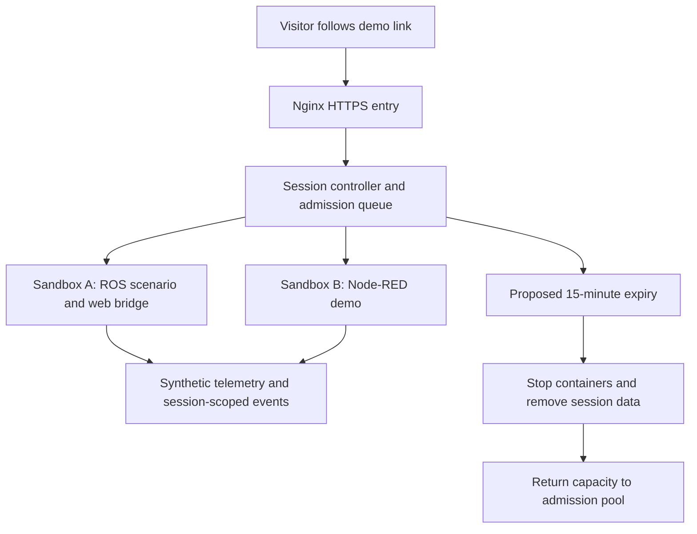

# KVM Hosting for Ephemeral Demo Sandboxes

[Documentation index](../README.md) · [Interactive demo plan](../business/interactive-demo-b2b-conversion-and-sandbox-plan.md)

## Purpose and status

This English consolidation translates the additional Spanish cloud-infrastructure note. It proposes a Hostinger KVM VPS for browser demos, ROS 2/Gazebo simulation scenarios and telemetry dashboards, aiming to balance cost and performance without a complex hyperscale architecture. “Ideal balance” is the source's preference, not a benchmarked provider comparison.

This is a hosting proposal. No VPS was purchased, infrastructure deployed or concurrency benchmark run. Provider terms were checked on 12 October 2026; exact availability and checkout conditions require confirmation before purchase.

## 1. Proposed KVM advantages and qualifications

- **Hardware-assisted virtualization:** the source contrasts KVM virtual machines with OpenVZ/LXC container environments and claims strict isolation, dedicated CPU/RAM/NVMe and freedom from noisy-neighbor slowdowns. KVM provides a VM boundary, but that alone does not establish exclusive physical CPU, storage or network resources. KVM uses Linux scheduling and memory management. The absolute performance guarantee is unsupported by the source. See the [KVM FAQ](https://www.linux-kvm.org/page/FAQ).
- **Administrative access:** root access is proposed for ROS 2, Node-RED, Docker and browser-delivery components. WebGL renders in the browser; WebRTC streaming requires a separate rendering/encoding pipeline. Installation permissions do not prove compatibility, GPU availability or simulation fidelity.
- **Modular sessions:** the source proposes a separate temporary Docker sandbox for each visitor, expiring after fifteen minutes. Provisioning, admission control, timers, teardown and orphan cleanup need an application controller; Compose alone is not a session lifecycle service.

KVM isolates the VPS from other guests. Containers within that VPS share its kernel and resource budget. Per-session limits and isolation must be designed and verified.

## 2. Source sizing and provider check

| Resource | Source recommendation | Intended workload |
| --- | --- | --- |
| CPU | 4–8 vCPU, described as dedicated | Concurrent lightweight simulations and Node.js/Python APIs |
| Memory | 16–32 GB | Multiple active sandbox containers |
| Storage | 200–400 GB NVMe SSD | FreeCAD models, visual assets and telemetry databases |
| Traffic | Unlimited or a high TB allowance | MQTT telemetry delivery and browser assets |

The [official Hostinger VPS page](https://www.hostinger.com/vps-hosting?lang=en) lists KVM 4 with 4 vCPU, 16 GB RAM, 200 GB NVMe and 16 TB traffic; KVM 8 has 8 vCPU, 32 GB RAM, 400 GB NVMe and 32 TB. It advertises root access. These are allocated specifications, not evidence of exclusive physical cores or guaranteed demo concurrency.

Displayed monthly equivalents were USD 12.99/25.99 initially and USD 28.99/49.99 at renewal for KVM 4/8; the page states upfront payment and a two-year renewal period. These are a dated page observation, not a quotation for a particular country/account. The source's “well below USD 50–80/month” refers to an unverified total-cost claim: administration, domain, optional services, taxes and simulation infrastructure also need budgeting.

## 3. Proposed deployment architecture

The original flow is a LinkedIn visitor (including India/Brazil examples) entering a VPS and receiving a Docker/ROS web or Node-RED UI sandbox. The normalized flow makes the missing lifecycle controller explicit:

**Compose:** use it to define and run the multi-container stack, with explicit CPU/memory/PID limits. [Docker's application model](https://docs.docker.com/compose/intro/compose-application-model/) and [resource constraints](https://docs.docker.com/engine/containers/resource_constraints/) support these roles. Limits constrain consumption; they do not establish workload capacity.

**Web entry:** the source proposes Nginx and automated Let's Encrypt certificates. HTTPS setup needs domain routing, certificate issuance/renewal and an operational check. It does not guarantee instantaneous loading or complete application security. Browser telemetry needs a compatible HTTP/WebSocket or MQTT-over-WebSocket bridge.

**Cost and concurrency:** the source expects a mid/high-tier VPS to serve dozens of simultaneous visitors. This remains untested. Browser-local WebGL with synthetic telemetry, headless simulation and remote 3D streaming are different workloads. Do not infer server-side Gazebo rendering capacity or GPU support from vCPU/RAM specifications.

## Proposed validation before plan selection

Measure one representative session's peak memory, CPU, disk growth and network traffic. Reserve capacity for the host, proxy, controller and shared services; set an initial session cap from the tightest measured resource, then test under sustained concurrent load. Record scenario/version, session count, first-task latency, simulation real-time factor where relevant, errors, resource peaks and successful expiry cleanup.

Test session separation, queue behavior, restart/orphan recovery and data reset using synthetic inputs. Report the tested capacity and total monthly cost before adopting “dozens of users” or a savings claim. Define browser/device coverage and client-side versus server-side rendering explicitly.

Related planning: [interactive demo conversion](../business/interactive-demo-b2b-conversion-and-sandbox-plan.md) and [lean presales demonstrator](../strategy/lean-presales-demonstrator-plan.md). For scientific visualization specifically, see the [WebGL source review](../research/software/interactive-scientific-simulations-webgl.md).

## Source and coverage

[Immutable original: Infraestructura Cloud.txt](https://github.com/robotics-intelligent-systems/jfxai4mad/blob/acdd6e145492db744ac69c14e9f23a6704d6c864/docs/Infraestructura%20Cloud.txt).
Baseline commit: `acdd6e145492db744ac69c14e9f23a6704d6c864`; Git blob: `436abb436c1c3374ecdf50fac7c9da5a77d2e987`.

Coverage includes the opening hosting rationale, three KVM advantages, four sizing rows, original two-sandbox flow and Compose/Nginx/cost proposals. Provider checks, qualifications and validation steps are editorial additions. The English Markdown replaces the working TXT; Git history preserves the original.
