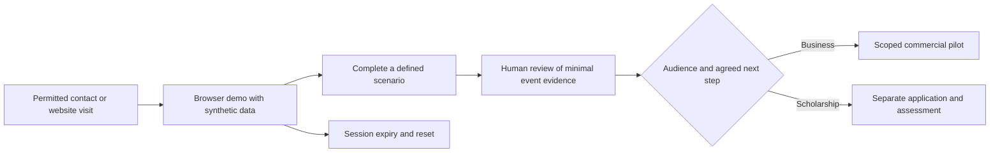

# Interactive Demo: B2B Conversion and Sandbox Plan

[Documentation index](../README.md) · [Strategy index](../strategy/README.md)

## Purpose and evidence status

This English consolidation translates the additional Spanish note about an online interactive demo or sandbox and product-led growth (PLG). The source proposes faster acquisition by allowing prospects and scholarship applicants to try management workflows and digital-twin scenarios before a meeting.

All conversion rates, response rates, timing, cost and recruitment effects are illustrative source assumptions. No experiment, deployed sandbox or measured improvement is documented. Commercial customers and scholarship applicants require separate funnels and outcomes.

## 1. Conversion scenarios and arithmetic

The source contrasts cold outreach and static forms with immediate browser access:

| Stage | Traditional outbound assumption | Interactive-demo assumption |
| --- | --- | --- |
| Initial engagement | Form/chat: 2–5% of contacts | Immediate browser demo: 25–40% of contacts |
| Next stage | Scheduled demo: 10–15% of form/chat entrants | Active qualification: 30% of demo entrants |
| Final outcome | Customer/applicant: 10% of scheduled demos | Customer/applicant: 25% of qualified entrants |
| Source global claim | About 0.05–0.1% | About 1.8–3.0% |
| Recomputed sequential product | **0.02–0.075%** | **1.875–3.0%** |

These products assume each rate is conditional on the preceding stage and uses the same cohort. If the source rates use different denominators, multiplication is invalid. For 30,000 initial contacts, the products imply 6–22.5 traditional outcomes or 562.5–900 interactive outcomes as expected scenario values, not forecasts or fractional people.

The source claims a 15–30× efficiency improvement. Its tabulated rounded baseline of 0.1% and demo range of 1.5–3.0% yield that ratio, but the sequential funnel above yields a mathematical envelope of 25–150×. Neither is a demonstrated effect; the source mixes ranges and definitions.

| Metric | Source traditional scenario | Source online-demo scenario | Interpretation |
| --- | --- | --- | --- |
| Time to first experience (TTV) | 3–7 days to arrange a meeting | Under 30 seconds | Target; source claims 99% friction reduction. At exactly 30 seconds, elapsed-time reduction exceeds 99.98%, but time is not a measurement of friction. |
| LinkedIn response | 10–15% | 35–50% | Source labels this “+200% opening/response.” Extreme comparisons imply about +133–400% relative change; opening and response must be measured separately. |
| Applicant/lead qualification | Manual interview | Usage-based qualification | Proposed prioritization aid; completion alone does not establish suitability. |
| Contact-to-activation conversion | About 0.1% | 1.5–3.0% | Separate source summary scenario; activation is not necessarily a paying customer or accepted applicant. |

## 2. Proposed ecosystem mechanisms

- **Lower perceived risk:** showing cloud management workflows and ROS 2, FreeCAD or Grafana-related simulations may help prospects inspect functionality. A demo supports only the behavior it actually demonstrates; a mock does not prove production integration or quality.
- **Inbound interest from volunteers:** the source imagines engineers in India or Brazil trying a floating-plant twin or management system before applying to Barranco. Usage may express interest; scholarship eligibility and technical competence still require human assessment.
- **Acquisition from a 30,000-contact inventory:** a demo link in LinkedIn outreach could support self-onboarding and reduce individual follow-up. The inventory, contact permissions, reach, timelines and the claimed ability to acquire 100 customers or 100 scholarship participants remain unverified. Contacts are not automatically qualified leads.

## 3. Proposed lightweight implementation

The source aims for low cost and free-software reuse:

| Component | Proposed role | Acceptance evidence |
| --- | --- | --- |
| Browser WASM/WebGL view | Render a floating microfactory twin without installation | Named browser/device matrix, loading time and completion of one simulated task |
| Ephemeral cloud sandbox | Temporary access, with a proposed 15-minute session, to open-banking, agricultural consignment POS and machine-telemetry scenarios | Synthetic records, mock integrations, isolation, expiry and reset checks |
| Minimal usage analytics | Record actions such as activating a robot-arm simulator or configuring an agricultural module | Defined event schema, disclosed collection and a tested human-review queue |

Browser rendering alone does not demonstrate physics fidelity or execute every desktop tool. The source does not specify a working ROS 2/FreeCAD/browser bridge. Open-banking flows should initially use synthetic fixtures and mock APIs; this note does not authorize financial transactions.

The 15-minute sandbox duration and under-30-second first-experience objective are separate design targets. Hosting, integration, support and maintenance costs need estimation before claiming low-cost operation.

## Measurement and next step

Define visitor, demo-start, task-complete, qualified-lead, paid-customer and scholarship-acceptance events separately. Use unique eligible participants and a stated observation window; exclude staff, bots and duplicate sessions. Record each conditional numerator/denominator, end-to-end conversion, time to first successful task and total acquisition cost.

Compare equivalent cohorts, preferably by randomized assignment, and report counts, uncertainty and follow-up maturity. Do not attribute changes to the demo without addressing audience, offer and outreach differences. Use aggregate usage for initial evaluation; any identifiable collection needs a clear purpose and appropriate consent.

The next proposed task is to specify one synthetic scenario and its event contract, then evaluate a limited pilot. No outreach, recruitment, financial integration or sandbox deployment is performed by this documentation migration.

Related notes: [presales demonstrator](../strategy/lean-presales-demonstrator-plan.md), [contact acquisition](linkedin-contact-acquisition-and-lead-velocity.md), [payroll and B2B conversion](ten-skilled-jobs-payroll-and-b2b-conversion.md), and [Barranco hub](../strategy/barranco-residential-training-hub-operating-model.md).

## Source and coverage

Original: [Impacto de una Demo en.txt](https://github.com/robotics-intelligent-systems/jfxai4mad/blob/08f1cd6b989865b15d7e64310c2b27ed1b96ab77/docs/Impacto%20de%20una%20Demo%20en.txt).
Baseline commit: `08f1cd6b989865b15d7e64310c2b27ed1b96ab77`; Git blob: `e600997072eacb2d2206e2be434262558a8c94e1`.

Coverage includes the opening PLG premise, both funnels, every comparison-table row, all three proposed mechanisms and all three implementation components. Arithmetic corrections and evaluation requirements are editorial additions. The descriptive English Markdown replaces the working TXT; the original remains in Git history.

Hosting follow-up: [KVM infrastructure and ephemeral sandbox plan](../architecture/kvm-hosting-ephemeral-demo-sandbox.md).
