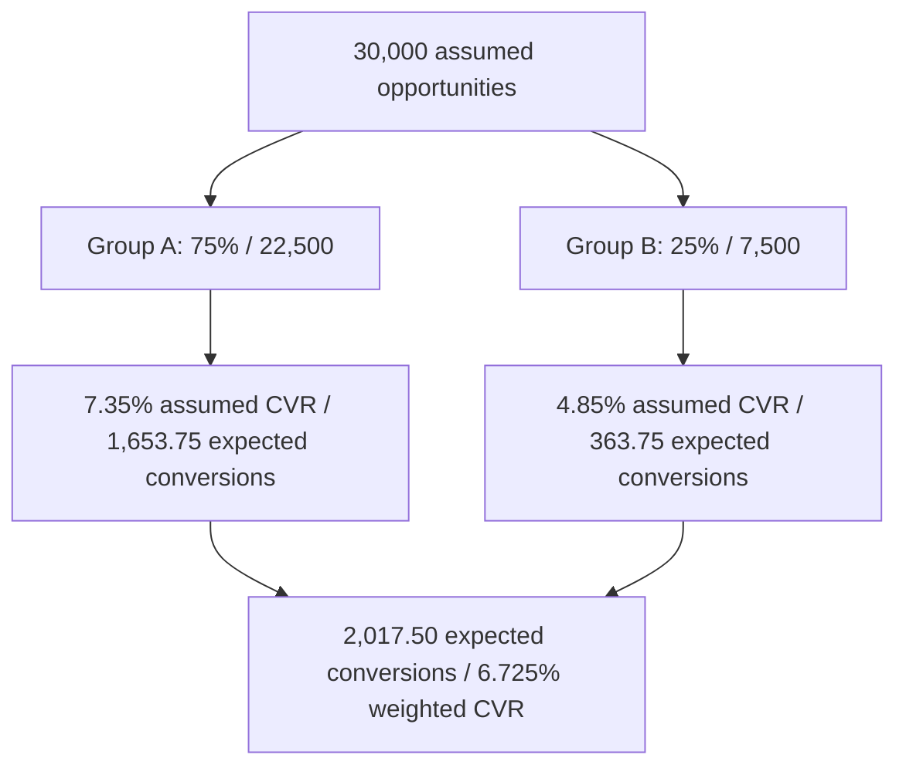

# Latin American Opportunity Segmentation and Conversion Scenario

[Documentation index](../README.md) · [Regional hiring scenario](regional-hiring-hubs-and-market-distribution.md)

**Status:** translated planning scenario, with corrected terminology and arithmetic. No opportunity dataset, campaign results or reproducible market benchmark accompanies the source. The 30,000 opportunities, allocation and conversion rates are assumptions, not observed performance.

## 1. Scope and country groups

The source proposes analyzing 30,000 opportunities in Latin America, excluding Eurasia, Oceania and North America. Its country list nevertheless includes Mexico, which is geographically in North America and culturally part of Latin America. This note interprets the intended scope as the listed Latin American markets, including Mexico, and exclusion of the United States and Canada. Confirm that interpretation before collecting data. The list is a selected market set rather than exhaustive regional coverage.

| Internal scenario group | Countries | Assumed allocation |
| --- | --- | ---: |
| A: five larger markets (source: “Emerging Block”) | Brazil, Mexico, Colombia, Argentina, Chile | 75% / 22,500 |
| B: eleven additional markets (source: “N-11 LATAM”) | Peru, Ecuador, Dominican Republic, Guatemala, Costa Rica, Uruguay, Panama, Bolivia, Paraguay, El Salvador, Honduras | 25% / 7,500 |

These are project-specific segments. Neither user density nor B2B advertising volume establishes the allocation in the supplied text.

### Correction to “Next Eleven”

The established Goldman Sachs N-11 comprises Bangladesh, Egypt, Indonesia, Iran, Mexico, Nigeria, Pakistan, the Philippines, South Korea, Türkiye and Vietnam. Mexico is its only Latin American member, and the source puts Mexico in group A. The eleven countries in group B therefore cannot be presented as the established N-11. See [Goldman Sachs fund disclosure filed with the SEC](https://www.sec.gov/Archives/edgar/data/822977/000119312526301024/d308160d485apos.htm), checked on 13 October 2026. The original label is retained only for source traceability.

## 2. Distribution and conversion calculations

Expected conversions = opportunities × assumed conversion rate. Fractional expectations are valid model outputs; rounded counts are illustrative and do not imply actual people or companies converted.

| Metric | Group A | Group B | Combined |
| --- | ---: | ---: | ---: |
| Allocation | 75% | 25% | 100% |
| Opportunities | 22,500 | 7,500 | 30,000 |
| Assumed CVR range | 6.5–8.2% | 4.2–5.5% | **5.925–7.525% weighted** |
| Midpoint CVR | 7.35% | 4.85% | **6.725% weighted** |
| Expected midpoint conversions | 1,653.75 | 363.75 | **2,017.50** |
| Rounded midpoint counts | 1,654 | 364 | 2,018 |
| Expected range | 1,462.50–1,845.00 | 315.00–412.50 | 1,777.50–2,257.50 |

The source's approximately 6.0–7.5% combined interval is a rough approximation; the exact fixed-allocation interval is shown above. These endpoints apply both group minima or both maxima simultaneously and are not confidence intervals.

## 3. Source explanations and their evidence limits

**Group A.** The source attributes its 7.35% midpoint (6.5–8.2% range) to greater B2B digital maturity, higher click-through rates, established LinkedIn Lead Gen Forms usage, and mid-sized/corporate decision-makers responding to direct or content campaigns. It singles out Brazil, Mexico and Colombia. These comparative explanations are unverified hypotheses.

**Group B.** The source attributes its 4.85% midpoint (4.2–5.5% range) to lower B2B penetration, lower CPC/CPM, longer sales funnels, more market education, lower native-form adoption and greater use of external landing pages. No country-level evidence or controlled native-versus-external comparison is supplied. Lower advertising competition and cost are also unverified.

Do not infer country-level rates from the group averages. Differences in audience, industry, campaign objective, language, spend, creative, qualification, conversion window and attribution can explain observed differences. CTR is clicks per impression; it is distinct from conversion rate.

## 4. Direct comparison

| KPI | Calculation | Meaning within this scenario |
| --- | --- | --- |
| Opportunity difference | 22,500 − 7,500 = 15,000 | Group A has three times the assumed volume |
| Absolute CVR difference | 7.35% − 4.85% = 2.50 percentage points | Not “2.50%” relative uplift |
| Relative CVR uplift | (7.35 / 4.85 − 1) × 100 = 51.546% | Approximately 51.5% above group B |
| CVR ratio | 7.35 / 4.85 = 1.51546 | Approximately 1.52×; source says 1.51× |
| Group A conversion share | 1,653.75 / 2,017.50 = 81.970% | Approximately 82% of modeled conversions |
| Conversion-volume ratio | 1,653.75 / 363.75 = 4.54639 | Combines allocation and rate assumptions |

The source concludes that the “Emerging Block” is more efficient and produces most effective conversions. The arithmetic supports a higher assumed CVR and conversion share, but it does not demonstrate actual efficiency, lower acquisition cost, higher revenue or return on investment. Cost and conversion quality are missing.

## 5. Project integration and next task

This is a separate 30,000-opportunity LATAM-only scenario. The [regional hiring note](regional-hiring-hubs-and-market-distribution.md) allocates only 12,000 of its 30,000 contacts to LATAM and uses contact-to-paid rates near 0.10–0.125%. The [demo funnel](interactive-demo-b2b-conversion-and-sandbox-plan.md) also uses different denominators and stages. Do not replace those rates with 6.5–8.2% or 4.2–5.5% or convert the present totals into SaaS customers/ARR without identifying the conversion event.

**MAD-LATAM-001 — next AI-assisted task:** prepare a country-by-country evidence matrix identifying unique opportunity units, deduplication, time period, channel, funnel stage, conversion event, eligible denominator, spend, language, industry and source provenance. Verify allocation against an actual inventory and calculate group CVR as total conversions / total eligible opportunities. Keep lead submissions, qualified leads, demos and paying customers separate. Compare cost per qualified lead and customer acquisition cost before selecting markets. No campaign, outreach or dataset collection is initiated by this note.

## Source and coverage

[Immutable original: Para analizar el universo.txt](https://github.com/robotics-intelligent-systems/jfxai4mad/blob/88545f7bce1541d3c39be54d23f88e34ffb0adbc/docs/Para%20analizar%20el%20universo.txt).

Baseline commit: `88545f7bce1541d3c39be54d23f88e34ffb0adbc`; original Git blob: `72f350986adb2efb6b486794ccbab817cb1a8cbe`.

Coverage includes the opening scope; all four numbered sections; both country lists; all allocation, range, midpoint and comparison rows; every proposed performance explanation; and the conclusion. Terminology, scope qualification, exact arithmetic, measurement requirements and project cross-references are editorial additions. The working TXT is replaced by English Markdown while Git history preserves the original.
