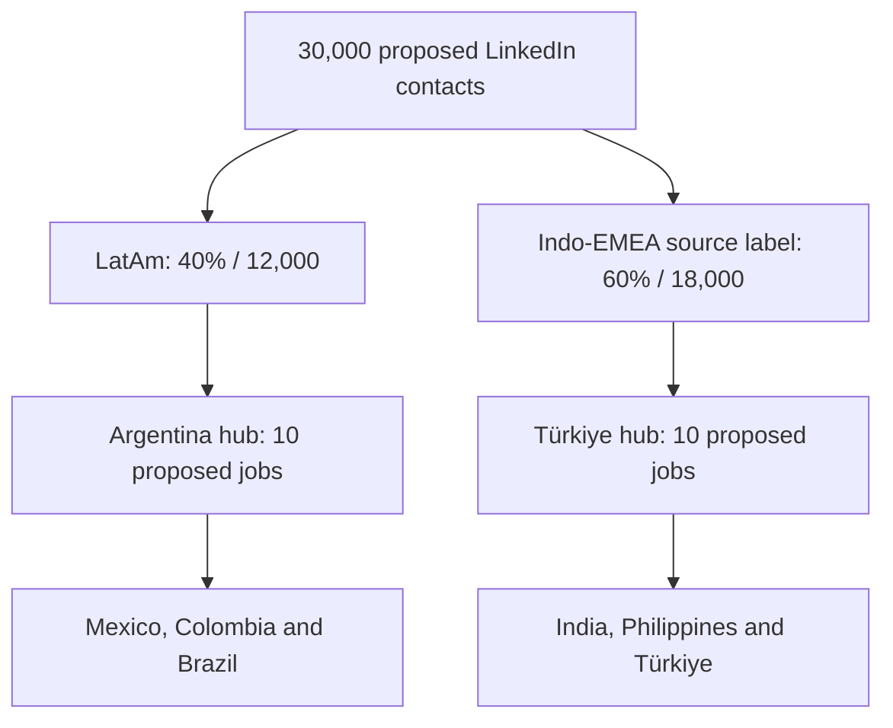

# Regional Hiring Hubs and Market Distribution

English translation and consolidation of the supplemental Spanish note. **Status:** planning scenario. Salary ranges, market demand, contact availability, conversion and financing are unverified source assumptions. This revision proposes twenty jobs instead of the earlier ten-job Argentina/California alternatives.

## 1. Regional staffing model

The source proposes a hub-to-market arrangement based on cultural, time-zone and language proximity. These advantages require validation: Brazil and the Philippines, for example, need distinct language and service-hour coverage.

“Indo-EMEA” is the source's internal grouping, including the Philippines; it is not a standard geographic classification. Contacts are a proposed universe, not verified connections, qualified leads or unique customer companies. See the [contact-acquisition note](linkedin-contact-acquisition-and-lead-velocity.md).

## 2. Financial viability and salary comparison

The source replaces California with Argentina and Türkiye and claims lower operating costs make low-cost B2B cloud self-financing viable. The figures below do not establish that conclusion.

| Indicator | Argentina / LatAm hub | Türkiye / Indo-EMEA hub |
| --- | --- | --- |
| Markets served | Mexico, Colombia, Brazil | India, Philippines, Türkiye |
| Proposed jobs | 10 | 10 |
| Assumed annual cost per employee | USD 30,000 | USD 28,000–32,000 |
| Source annual payroll estimate | USD 300,000 | USD 300,000 |
| Range implied by employee estimate | USD 300,000 | USD 280,000–320,000 |
| Source payroll-only subscription target | About 84 customers | About 84 customers |

Combined source payroll is USD 600,000/year for twenty jobs; the implied range is USD 580,000–620,000. Salary estimates are not current quotations and their inclusion of employer charges is unresolved.

At the [earlier scenario's](ten-skilled-jobs-payroll-and-b2b-conversion.md) USD 300/month price, each full-year customer yields USD 3,600 ARR. A USD 300,000 payroll requires 84 subscriptions when rounded up; both hubs independently require 168 subscriptions, yielding USD 604,800. A pooled USD 600,000 target requires 167, yielding USD 601,200. The combined range requires 162–173 pooled subscriptions. These are gross revenue equivalents before delivery costs, taxes, churn and cash timing.

## 3. Distribution of 30,000 contacts

All country percentages below refer to the complete 30,000-contact universe.

| Block / operating hub | Country | Total share | Contacts | Source market rationale |
| --- | --- | ---: | ---: | --- |
| Indo-EMEA / Türkiye | India | 30% | 9,000 | Startup volume and cloud infrastructure |
| Indo-EMEA / Türkiye | Philippines | 15% | 4,500 | BPO, digital services and IT integration |
| Indo-EMEA / Türkiye | Türkiye | 15% | 4,500 | Europe–Asia commerce, fintech and manufacturing/software |
| LatAm / Argentina | Mexico | 15% | 4,500 | Technology nearshoring and industrial SMEs |
| LatAm / Argentina | Brazil | 15% | 4,500 | Fintech and agricultural technology |
| LatAm / Argentina | Colombia | 10% | 3,000 | SaaS and B2B software development |
| Total | Six markets | 100% | 30,000 | Unverified targeting hypotheses |

The source projects 18–22 paying Indo-EMEA customers and approximately USD 79,000 ARR, plus 12–15 LatAm customers and approximately USD 54,000 ARR.

| Block | Contacts | Source customer range | ARR at USD 3,600/customer | Source ARR |
| --- | ---: | ---: | ---: | ---: |
| Indo-EMEA | 18,000 | 18–22 | USD 64,800–79,200 | About USD 79,000 |
| LatAm | 12,000 | 12–15 | USD 43,200–54,000 | About USD 54,000 |
| Combined | 30,000 | 30–37 | USD 108,000–133,200 | About USD 133,000 |

The quoted ARR approximates the upper ends of the customer ranges. It does not represent every outcome within them. Implied contact-to-paid conversion is 0.10–0.1222% for Indo-EMEA, 0.10–0.125% for LatAm and 0.10–0.1233% overall. These are modeled expectations, not measured results.

## 4. Financial coverage and closing the gap

**Phase 1 — direct outbound conversion.** The source expects roughly USD 133,000 ARR to support initial hiring. Against USD 600,000 payroll, that is 22.17% gross coverage and a USD 467,000 annual gap before operating costs. The exact upper-end scenario, 37 customers, yields USD 133,200, 22.2% coverage and a USD 466,800 gap; the low end yields USD 108,000, 18% coverage and a USD 492,000 gap.

At an assumed USD 30,000 per job, the upper-end revenue is equivalent to 4.44 jobs before costs. It cannot establish funding for twenty jobs or a safe initial hiring count.

**Phase 2 — full sustainability.** The source proposes closing the gap with:

1. Surplus from algorithmic trading and open banking in the [value-architecture proposal](value-architecture-and-financing.md). No surplus or committed financing is evidenced; open banking itself is not revenue.
2. Recurring low-cost cloud SaaS/PLG subscriptions. Identify incremental customers separately from outbound customers to avoid counting the same recurring revenue twice.

For illustration at the inherited price, reaching the pooled payroll-only target of 167 from 37 customers requires 130 additional full-year subscriptions (USD 468,000 ARR). Actual funding needs depend on contribution margin, collections and fully loaded costs; this is arithmetic rather than financial advice or a verified forecast.

## Consolidation and validation gates

This note is the later regional revision to the [ten-job scenario](ten-skilled-jobs-payroll-and-b2b-conversion.md): it changes headcount, replaces California, and expands India/Brazil targeting to six countries. Preserve the earlier scenario as a historical alternative; do not add its ten jobs to this twenty-job model.

Use the [business KPI framework](business-model-and-kpis.md) to measure unique company accounts, dated funnel cohorts, realized pricing, retention, contribution margin and cash runway. The [investment roadmap](../roadmap/implementation-and-investment.md) should gate hiring on funded payroll and observed delivery economics. Regional languages, service hours and employment-cost estimates need validation before commitments.

## Source migration record

| Field | Record |
| --- | --- |
| Original filename | `docs/1 Reestructuración del.txt` |
| English destination | `docs/business/regional-hiring-hubs-and-market-distribution.md` |
| Source commit | `6c9daaeaf5f97d7592a16532982b693578cba2b1` |
| Original Git blob | `7e81f4ef997e320076fdf33498877078954d1395` |
| Immutable original | [Spanish source](https://github.com/robotics-intelligent-systems/jfxai4mad/blob/6c9daaeaf5f97d7592a16532982b693578cba2b1/docs/1%20Reestructuraci%C3%B3n%20del.txt) |
| Processing date | 2026-10-12 |
| Coverage | All four numbered sections; staffing diagram; salary comparison; six country allocations; both customer/ARR projections; both funding phases |
| Editorial treatment | Reconstructed tables and Mermaid; assumptions separated from arithmetic; no external salary or market validation |

The working TXT is replaced with English Markdown; Git history preserves the original. No hiring, outreach, trading or financing is performed.

[Documentation index](../README.md) · [Consolidated annex](../ANNEX-DOCS-CONSOLIDATED.md#35-regional-hiring-hubs-and-market-distribution)

## Separate LATAM-only scenario

The later [30,000-opportunity LATAM segmentation note](latam-opportunity-segmentation-and-conversion-scenario.md) uses a different geographic universe and an undefined conversion event. Its modeled 6.725% weighted CVR must not replace this note’s contact-to-paid assumptions or be used directly for payroll/ARR projections.
