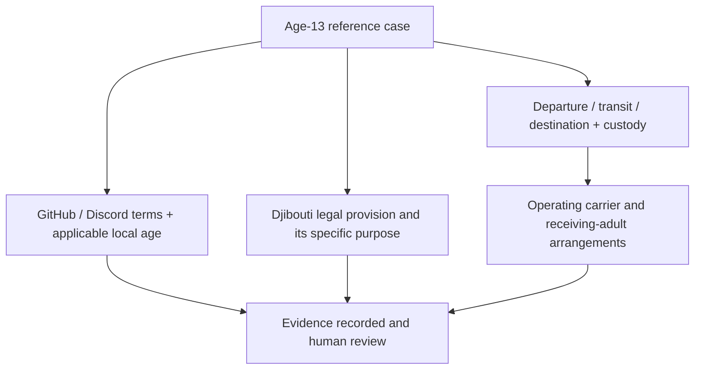

# Age 13 — Djibouti, GitHub, Discord and Travel Authorization

## Scope and provenance

**Thirteen years is the explicit minimum-age reference under analysis.**
This preserves the source's age-13 focus and the user's additional instruction
to cover Djibouti, GitHub and Discord. The table below identifies the exact
meaning and evidentiary status of that threshold in each framework.

Source: `docs/Para estructurar un enfoque.txt`, migration entry **64**.
Review date: **10 October 2026**. Original retained in
[Git history](https://github.com/robotics-intelligent-systems/jfxai4mad/blob/ea27e17f52d592ebc55f4ce41bf2384be5a4e752/docs/Para%20estructurar%20un%20enfoque.txt).

- Commit: `ea27e17f52d592ebc55f4ce41bf2384be5a4e752`.
- Git blob: `ccad8cebc3554d83831cb158f11c696e4559ea73`.
- SHA-256: `5b7a2ed4de4aa8ef347a5a4975ffc3557d2526a5dbccfa6d73059582084a4aa6`.

The source's first component is preserved in the
[natality-incentive model proposal](../public-policy/natality-incentive-probability-model.md).
This note processes its second component and the later user clarification.
Platform eligibility is not evidence of independent travel authority.

## Highlighted age-13 framework

| Framework | Role of **13 years** | Verified scope and qualification |
| --- | --- | --- |
| GitHub | **Minimum platform-user age: 13** | Terms prohibit users under 13; a higher local minimum can apply. [GitHub terms, B.3](https://docs.github.com/en/site-policy/github-terms/github-terms-of-service#3-account-requirements) |
| Discord | **Minimum platform-user age: 13** | Terms also require the country-specific minimum; minors need the parent/guardian agreement specified there. [Discord terms](https://discord.com/terms) |
| Djibouti | **13 is a statutory juvenile-procedure boundary** | The published 2015 minors-protection law, Article 51, prohibits police custody below 13. Article 2 generally defines a minor as under 18, subject to special majority provisions. This is not a minimum age to travel or a platform-account rule. [Official law](https://www.journalofficiel.dj/texte-juridique/loi-n95-an-15-7eme-l-portant-code-de-protection-juridique-des-mineurs/) |
| International travel at age 13 | **Age-13 case for authorization review** | The draft's universal minimum/permission rule is not established. Check departure, transit, destination, custody and carrier rules for the itinerary. |
| Carrier assistance at age 13 | **Different treatment by carrier** | KLM and LATAM publish different assistance age bands; neither creates a universal international-law minimum. |

The requested age-13 premise remains visible as the study parameter. The
review does **not** establish 13 as a general Djiboutian age of majority, travel
minimum, marriage age or reproductive-policy eligibility threshold. Those are
separate legal questions; account terms cannot answer them.

## Source translation: parental authority and travel

The source proposes a technical/legal framework for intercontinental travel
by minors, particularly thirteen-year-olds. It asserts:

1. Every minor requires express written authorization with notarial, consular or
   judicial validity from those exercising parental authority.
2. Airlines treat children below thirteen as a critical assistance category,
   with unaccompanied-minor services extending to fourteen or seventeen.
3. A thirteen-year-old must have departure permission signed by both parents,
   or the absent parent, and contact/responsibility details for the receiving adult.
4. The Convention on the Rights of the Child combats illicit international
   transfers and therefore reinforces border safeguards at thirteen.

These are normalized source assertions. Their universal wording and the age
cutoff are qualified by the checks below; they are not an approved travel checklist.

## Djibouti: historical travel law and verification limit

A preserved copy of the official 2007 anti-trafficking law contains an under-18
departure-authorization provision in Articles 14–15. However, Article 40 of the
2016 anti-trafficking law expressly repeals that 2007 law. The historical
authorization text cannot be presented as the current rule. This review did not
establish the current departure procedure or any minimum age of thirteen for it.
[2007 official-text copy](https://www4.aucegypt.edu/CMRS/Files/55.pdf),
[2016 official repeal](https://www.journalofficiel.dj/texte-juridique/loi-n133-an-16-7eme-l-portant-sur-la-lutte-contre-la-traite-des-personnes-et-le-trafic-illicite-des-migrants/)

The Article-51 threshold above is a narrowly identified statutory reference.
Current consolidated rules and administrative implementation still require
verification before a Djibouti travel case is assessed. No authority was contacted.

## Selected carrier comparison for a thirteen-year-old

| Published carrier policy | Treatment of age 13 |
| --- | --- |
| LATAM Colombia help page | The published 12–17 band may travel alone; unaccompanied-minor assistance is optional, subject to documents and itinerary restrictions. The service is not available for codeshares/connections with other airlines. [LATAM policy](https://www.latamairlines.com/co/es/centro-ayuda/preguntas/necesidades-especiales/menor-viajar-solo-avion/requisitos-viaje) |
| KLM | Unaccompanied-minor assistance is mandatory for ages 5–14 when traveling without an accompanying adult of 18+, or in a different cabin; 15–17 is optional. Transfers have operator restrictions. [KLM policy](https://www.klm.nl/en/information/assistance-health/children-travelling-alone) |

These are dated policy checks, not route bookings or guarantees of boarding.
Age at each travel segment and the actual operating carrier must be reviewed.

## Treaty basis and project workflow

CRC Article 11 requires states to combat illicit transfer and non-return of
children abroad; it does not prescribe a universal thirteen-year travel minimum
or a single parental-permission form. [Convention text](https://www.unicef.org/child-rights-convention/convention-text)

For a proposed JFXAI4MAD educational/collaboration workflow, record platform
minimum, applicable local rule, relevant guardian agreement and age-appropriate
community scope separately. Travel coordination additionally needs documented
custody authority, applicable departure/transit/entry rules, carrier acceptance
and verified pickup arrangements. No account, community or travel service is
activated by this document.

Research participation and platform access remain separate from the project's
adult-discovery and marriage-service scope. No legal entitlement is inferred
from nationality or from permission to hold a GitHub/Discord account.

[Research index](../README.md) · [Documentation index](../../README.md) ·
[Prior Djibouti source review](djibouti-child-marriage-source-review.md)
