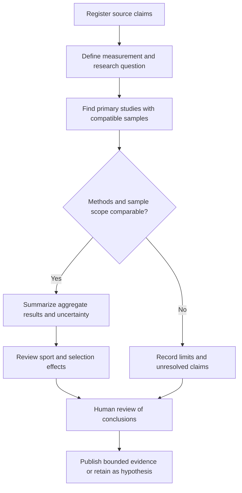

# Female Athlete Anthropometry: Geographic Claims and Measurement Review

**Status:** English normalization of migration entry 67; selected primary-source checks, with regional claims unresolved.  
**Reviewed:** 11 October 2026.  
**Scope:** sports-science research and possible ergonomic measurement questions. This note does not establish a worldwide distribution of athletes' body measurements.

## 1. Source provenance and coverage

The undated Spanish draft contains an introductory explanation, three numbered themes, five geographic examples and a three-row summary. It provides no bibliography, sample sizes, measurement protocols, observation years or athlete-level dataset.

- Original: `docs/Distribución Geográfica.txt`.
- Source commit: `79dfc73d8c9f02fc0bfb413e5fbd1cf708411b45`.
- Original Git blob: `720db3ca05afde6ade131eff575b7a2b7cfa80b4`.
- Original UTF-8 size: 2,056 bytes.
- SHA-256: `6d54c532a14493713d7368d8f1b8214ce9bfe8923eb1f3d0526bc32307fae4c9`.
- [Original at the reviewed commit](https://github.com/robotics-intelligent-systems/jfxai4mad/blob/79dfc73d8c9f02fc0bfb413e5fbd1cf708411b45/docs/Distribuci%C3%B3n%20Geogr%C3%A1fica.txt).

The source is retained in Git history after removal of the working TXT copy. Sections 2–3 preserve its content as attributed assertions; sections 4–7 are editorial analysis and a proposed research task. Instructions or explanations inside the draft are source material, not authorization to collect measurements or infer attributes of real people.

## 2. Translated source assertions

**All assertions in this section are inherited, not established findings.** The draft attributes global differences in women's athlete measurements—height, hips and bust—to population genetics and specialization in physically demanding sports. It provides no evidence that separates these explanations from athlete selection, training, nutrition, environment, age, playing position or measurement differences.

### 2.1 Greater stature

- **Northern and Eastern Europe:** the draft names the Netherlands, Nordic countries and the Balkans as populations with high average stature. It states that female volleyball, basketball and rowing athletes from these areas commonly exceed **1.80 m**. The implied prevalence and regional athlete comparison are unsupported.
- **East Africa:** the draft associates Kenyan and Ethiopian endurance runners, including marathon runners, with slender builds, long limbs and low body-fat percentages. It supplies no height distribution; this example does not itself support the heading's claim of greater stature.

### 2.2 Hip and lower-body development

- **Caribbean and West Africa:** the draft names Jamaica, Nigeria and Trinidad and Tobago, attributing pronounced pelvic, gluteal and hip musculature among sprinters and power athletes to explosive acceleration. Neither the regional comparison nor its causal explanation is documented.
- **Oceania:** the draft names Samoa, Fiji and Tonga and associates female rugby and other contact/power athletes with robust skeletal builds and greater hip and lower-limb breadth. It supplies no measurements that distinguish skeletal breadth, muscle size or circumference.

### 2.3 Bust and upper-body development

- **North America and Central Europe:** the draft names the United States, Canada and Germany. It associates swimmers, rowers and strength athletes with broader thoraces, wide shoulders and more developed pectoral/upper-body musculature. These are different quantities from breast size or bust circumference; the source does not measure any of them or establish a regional ranking.

## 3. Source summary table

The original's three rows are translated below without treating them as a validated classification. East Africa and North America occur in the prose but are absent from the original summary.

| Geographic group in the source | Sports named in the source summary | Attributed characteristic, unverified |
| --- | --- | --- |
| Northern / Central Europe | Volleyball, swimming, rowing | Greater stature and thoracic breadth, which the source labels as bust |
| Caribbean and West Africa | Sprint athletics | Greater power, musculature and volume around the hips |
| Oceania | Rugby and strength sports | Broad skeletal structure and general robustness |

No row establishes an individual athlete's anatomy, ability or equipment size. Country of residence, nationality, ancestry and competition representation are not interchangeable research variables.

## 4. Selected evidence checks

### 4.1 Sport-specific samples do not establish geographic prevalence

A primary study of **80 elite female players** in five team sports reports sample mean heights of **184.3 ± 4.2 cm** in volleyball (`n=18`) and **185.8 ± 9.0 cm** in basketball (`n=14`). It compared measured sport groups, using bioimpedance for body-composition variables. These sample means are consistent with tall athletes in those particular groups; they do not show that athletes throughout the source's regions commonly exceed 1.80 m, nor validate its rowing or geographic-genetic claims. A group mean also does not give the proportion above a threshold. [Mala et al., 2015](https://pmc.ncbi.nlm.nih.gov/articles/PMC4415834/).

### 4.2 Breast and torso dimensions require separate measurement

A primary study used 3D scans of **117 female contact-football players** across four codes to characterize breast and torso dimensions for sports-bra and protective-equipment design. It supports measuring these quantities separately for a specified use and sample. It does not establish that swimmers or rowers in North America or Central Europe have larger breasts. Only the abstract was reviewed here. [Brisbine et al., 2020](https://pubmed.ncbi.nlm.nih.gov/32301393/).

**Editorial correction:** chest girth, shoulder breadth, pectoral development and breast dimensions must have separate operational definitions. Likewise, hip circumference must not be substituted for pelvic skeletal breadth, gluteal muscle size or a measured power outcome.

### 4.3 Measurement quality is a prerequisite

The Australian Institute of Sport's anthropometry page describes ISAK accreditation and accuracy/reliability requirements for practitioners. This supports using documented measurement procedures and qualified assessors rather than visual guesses or nationality proxies. The page includes historical course dates; they are not current course availability. [AIS / Australian Sports Commission](https://www.ausport.gov.au/ais/performance-support/anthropometry).

### 4.4 What remains unresolved

No comparative dataset was identified and assessed here that validates the draft's worldwide height, hip or breast rankings, the claimed Kenyan/Ethiopian body-fat pattern, the Caribbean/West African hypertrophy comparison, or the Oceania skeletal-breadth generalization. No causal genetic analysis was performed. General-population height evidence would require a separate review and cannot automatically be transferred to selected athletes.

## 5. Measurement and comparison framework

This is a proposed evidence schema, not an implemented measurement service.

| Variable | Required definition and evidence |
| --- | --- |
| Stature | Standing height in cm; instrument, protocol, repeatability and sample distribution |
| Hip dimensions | Distinguish circumference in cm from specified skeletal breadth and muscle measures; record anatomical landmarks |
| Upper-body dimensions | Separate shoulder breadth, chest girth and breast measurements; record posture and equipment relevance |
| Body composition | State the assessment method and its assumptions; results from different methods are not automatically comparable |
| Performance | Specify the measured outcome; body size alone is not a power, endurance or ability score |
| Athlete sample | Sport, position/event, competition level, age band, season, sample size, selection method and observation period |
| Geographic context | Specify residence, training location or represented country; do not silently substitute nationality or ancestry |
| Statistics | Report distributions, uncertainty, exclusions and missingness; assess sport/position and sampling effects before regional comparisons |

Prefer aggregate, licensed research data for a first review. The project's [requirements and consent model](../../product/requirements-and-consent.md) remains applicable to any proposed personal-data use. This material supplies no consent to collect scans, scrape athlete photographs, infer intimate measurements from profiles or introduce body-based matching into adult social discovery.

## 6. Evidence workflow

## 7. Proposed next AI-assisted task

**MAD-ANTH-001 — Build an aggregate anthropometry evidence matrix.**

Prepare a reviewable matrix of primary studies for one bounded ergonomic question, initially stature-related accommodation in a specified adult athlete group. AI may assist extraction; a human reviewer confirms measurement definitions, sample scope and citations.

Acceptance criteria:

1. Record study identifier, year, sport, sample size, age scope, geography definition, units, protocol and uncertainty.
2. Separate sport-specific samples from general-population data and national rankings.
3. Trace every extracted number to its source table or passage; record missing fields rather than estimating them.
4. Document whether comparable data permit a conclusion; an unsupported result remains unresolved.
5. Use aggregate published evidence only for this first task; no personal measurement collection, ranking or matchmaking feature is included.

This is a proposed documentation task. No athlete dataset was assembled, model fitted, physiological assessment performed or product feature implemented.

## Reference register

| ID | Primary reference | Review scope |
| --- | --- | --- |
| ANT-01 | [Mala et al., Body Composition of Elite Female Players in Five Different Sports Games (2015)](https://pmc.ncbi.nlm.nih.gov/articles/PMC4415834/) | Full text and sample table; sport-specific evidence, not regional prevalence |
| ANT-02 | [Brisbine et al., Breast and torso characteristics of female contact football players (2020)](https://pubmed.ncbi.nlm.nih.gov/32301393/) | Abstract only; separate breast/torso measurement for equipment design |
| ANT-03 | [AIS / ASC, ISAK anthropometry accreditation](https://www.ausport.gov.au/ais/performance-support/anthropometry) | Measurement quality and practitioner scope; historical course page |

[Research index](../README.md) · [Documentation index](../../README.md) · [Migration register](../../ANNEX-DOCS-CONSOLIDATED.md#10-complete-migration-and-translation-register)
