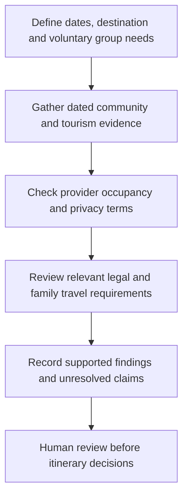

# Open-minded destinations and group hospitality

**Reviewed:** 12 October 2026  
**Status:** translated source review; destination comparisons remain hypotheses.  
**Original:** [docs/Cuando se evalúan destinos.txt](https://github.com/robotics-intelligent-systems/jfxai4mad/blob/ac50264ac4ec1090a4f64442a34fcbe81f74ad97/docs/Cuando%20se%20eval%C3%BAan%20destinos.txt)  
**Source commit:** `ac50264ac4ec1090a4f64442a34fcbe81f74ad97`  
**Git blob:** `2ef55606e1804fa72007616e7408ffef6f56bb7f`

## Translated source claims

The draft proposes evaluating destinations for openness toward unconventional relationship arrangements and describes an internationally recognized, nonjudgmental culture. This is the source's framing, not a measured ranking or a guarantee of treatment.

| Destination | Translated description from the draft | Evidence status |
| --- | --- | --- |
| Amsterdam, Netherlands | A pioneer in social rights and lifestyle diversity, with high acceptance of polyamory and ethical non-monogamy (ENM), and respect for individual privacy. | Tourism material confirms LGBTQI+ venues and events; comparative ENM acceptance and absolute privacy claims are unverified. |
| Berlin, Germany | Counterculture, bohemian settings and diverse communities where alternative relationship arrangements are common and integrated. | Tourism material documents LGBTQ+ events and welcoming hotels; citywide ENM prevalence is unverified. |
| Tulum and Puerto Escondido, Mexico | International digital-nomad and wellness communities where ENM and alternative cohabitation are common in social circles. | Community prevalence and citywide acceptance are unverified. |
| San Francisco and Portland, United States | Historical centers of the North American polyamory movement with events, workshops and friendly spaces. | Historical primacy, current event availability and comparative acceptance are unverified. |

ENM means consensual non-exclusive relationships among adults; polyamory is one possible arrangement. LGBTQ+ inclusion does not establish ENM acceptance. Neither label establishes another person's preferences or consent.

## Translated legal and cohabitation themes

1. **Culture and law.** The source distinguishes social acceptance from marriage recognition, asserts that no Western country recognizes polygamy or multiple marriages, and describes travelers as independent adults. The categorical regional claim is not established by this review. Existing marriage, parenthood, property and other legal relationships do not disappear during a trip. Polyamory, cohabitation, simultaneous civil marriages and recognition of foreign marriages require separate analysis.
2. **Accommodation and privacy.** The source describes shared villas and holiday residences as routine group bookings that do not require explanations about relationships. Treat this as a proposal to verify with the particular provider, not a universal hospitality rule. Confirm named guests, maximum occupancy, visitor rules, identification, deposits, cancellation terms and applicable registration requirements. Provide required booking information while limiting unnecessary intimate disclosures.
3. **Adults and consent.** The source requires adults in the destination jurisdiction for participation in the relationship arrangement. Project scope is consenting adults aged 18 or above who also meet any higher applicable local threshold. Adulthood, age-of-consent law, capacity and freely given ongoing consent are distinct checks.
4. **Children traveling with family.** The source separately identifies custody, travel authorization and legal guardianship requirements. Children may travel with families and are outside adult relationship activities. Required documents depend on nationality, route, custody and carrier; no universal border permission is inferred.

## Selected primary-source checks

Checked on 12 October 2026:

- [I amsterdam: LGBTQI+ scene](https://www.iamsterdam.com/en/see-and-do/guide-to-amsterdams-lgbtqi-scene) documents venues and cultural events. This supports a bounded claim about visible LGBTQI+ tourism offerings, not an ENM ranking or guarantee of safety.
- [visitBerlin: LGBTQ+ guide](https://www.visitberlin.de/en/gay-berlin-lgbtq-guide-berlin) documents community tourism offerings and welcoming accommodation. This does not establish universal acceptance of particular relationship arrangements.
- [Government of the Netherlands: marriage and cohabitation](https://www.government.nl/themes/family-health-and-care/marriage-cohabitation-agreement-civil-partnership/marriage-civil-partnership-and-cohabitation-agreements) distinguishes marriage, registered partnership, cohabitation agreements and informal living arrangements. It does not substantiate the draft's universal claim about Western jurisdictions.

Mexican and US destination comparisons, individual accommodation policies, multi-partner legal recognition and family travel permissions remain unresolved. No booking, legal eligibility determination or personalized recommendation is made.

## Proposed research workflow

For a future comparison, record destination, evidence date, source population, voluntary group requirements, provider terms and outstanding legal questions. Avoid assigning an openness score without a comparable survey and method.

## Related project material

- [Ethical non-monogamy and quarterly reviews](../../ethical-non-monogamy-quarterly-reviews.md)
- [Adult interaction and consent](../../adult-interaction-consent-and-sexual-health.md)
- [LGBT tourism demographic research](./lgbt-tourism-demographic-research.md)
- [Requirements and consent model](../../product/requirements-and-consent.md)
- [Documentation index](../../README.md)
- [Consolidated annex](../../ANNEX-DOCS-CONSOLIDATED.md)

The original TXT remains recoverable at the immutable source link and in Git history after replacement by this English Markdown note.
