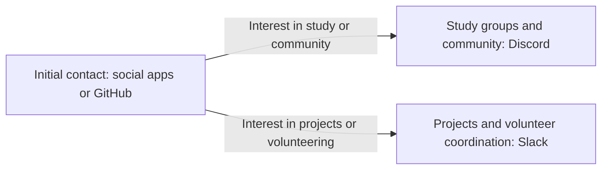

# Aeronautical Academy Outreach and Community Funnel

[Documentation index](../README.md) · [Strategy index](README.md)

**Status:** translated and consolidated proposal. It describes possible outreach routes for an Aeronautical Technical Instruction Academy; it does not establish that the academy, courses, volunteer programme, partnerships or community spaces are operating.

## Purpose and scope

The source proposes an alternative to relying only on LinkedIn to connect with prospective students, collaborators, volunteers and professional contacts around technical aviation education. It combines social discovery, open-source participation and opt-in learning or project communities.

The Spanish source specifically describes prospective women students, collaborators and volunteers among its intended contacts. It gives no eligibility rationale; any actual recruitment should use clear, role-relevant criteria.

The source gives no evidence of audience demand, platform suitability, enrolment, conversion or outcomes. Its platform examples, channel designs, free workshops, mentoring, volunteer roles and commission-based promotion are proposals, not verified services or commitments.

## Proposed attraction channels

| Channel | Source proposal | Qualification |
| --- | --- | --- |
| Dating and social apps | Tinder, OkCupid, Inner Circle and La Mutual are named as places to meet people interested in aviation, technology, engineering or expanding their social network. Use a clear profile describing technical aviation interests and educational projects; begin with shared interests and mention study or volunteering only if the conversation naturally turns to those topics. | These are source examples, not recommendations or a verified recruitment channel. Current platform rules and suitability were not reviewed. Any use would need honest disclosure and must respect each person's purpose and boundaries. |
| GitHub and open source | Create educational repositories about flight simulators, aeronautical systems or aviation data analysis; invite contributions in repository README files; and participate in related STEM, aviation and simulation projects. | No repository, invitation or collaboration is reported as created. Availability of contributors and project outcomes is unmeasured. |

The example profile is translated as: “Passionate about technical aviation and technology. Developing educational projects in aviation. I enjoy discussing science, technology and aviation and sharing projects with social impact. I am looking to connect with curious, passionate people.” It is illustrative source copy, not a validated profile or outreach message.

## Proposed community path

The draft routes interested contacts toward one of two opt-in spaces. A first contact does not imply permission to add someone to a group or recruit them.

### Discord: study groups and networking

The proposed audience is prospective students and other people interested in aviation. Suggested channels:

- **#welcome-and-introductions** — member introductions.
- **#aviation-101** — introductory conversations, free learning material and aviation history.
- **#study-groups** — physics, applied mathematics, technical English or preparation for licensing exams.
- **#coffee-and-conversation** — informal social discussion and coordination of meetings or events.

The channel list is a starting design only. The source does not establish a server, course catalogue, instructor coverage, aviation licensing pathway or learning result.

### Slack: volunteers and project collaborators

The proposed audience is technical collaborators, sales agents and project coordinators. Suggested channels:

- **#general-volunteering** — project updates.
- **#sales-and-outreach** — coordination for people considering promotion, commission-based work or other collaboration; terms and roles would need to be defined before any offer.
- **#academic-development** — course content, simulators and teaching material.

The source does not define volunteer compensation, commission terms, supervision, time commitments or employment status.

## Conduct principles from the source

1. **Separate personal and professional intentions.** Be transparent about aviation and education work in social or dating contexts. Do not make a personal or romantic interaction conditional on joining the academy or volunteering.
2. **Invite only after expressed interest.** Share a Discord or Slack invitation only when the person explicitly shows interest in aviation, study or technical collaboration.
3. **Offer value before a commercial pitch.** The source proposes free workshops, study material or technical aviation mentoring before commercial offers or recruitment. These must not be advertised as available until they are actually defined and staffed.

Because this proposal mixes dating contexts with education and recruitment, any future use should preserve the separation above: no misleading profiles, disguised recruiting, unsolicited group additions or pressure to participate. Respect privacy and verify current platform rules and participant age requirements before choosing a channel.

## Review gates before any pilot

- Define the academy's real programmes, eligibility, instructors, supervision and any applicable accreditation or licensing relationships before describing them publicly.
- Review current platform rules, age requirements, privacy expectations and permitted recruitment practices for each channel. The supplied source does not verify these.
- Define volunteer duties, time expectations, safeguarding, data handling, moderation, compensation and any commission terms before inviting participation.
- Keep participation voluntary and measure interest separately from enrolment, project contribution and learning outcomes. The source supplies no baseline or performance data.

## Related project documents

- [Student volunteer and SME open-source adoption strategy](./student-volunteer-sme-open-source-adoption.md) — proposed mentoring, volunteer roles and implementation safeguards.
- [Discord study groups and server design](../research/education/discord-study-groups-and-server-design.md) — community layout, privacy and moderation guidance.
- [Recruiter partnership outreach template](./recruiter-partnership-outreach-template.md) — a separate professional outreach draft with verification placeholders.

## Source coverage and provenance

This note translates and organizes the full source: its alternative-to-LinkedIn premise, named social and dating apps, sample profile, GitHub repository ideas, contact-to-Discord/Slack flow, every proposed channel group and its transparency, consent and value-first principles. Unsupported claims about reach, adoption or conversion are not presented as established facts.

The [immutable Spanish source](https://github.com/robotics-intelligent-systems/jfxai4mad/blob/bef726ea4f282b7703f9a1a4892b35aa3fb9abc3/docs/Para%20estructurar%20una%20estrategia.txt) is preserved in Git history. Original commit: `bef726ea4f282b7703f9a1a4892b35aa3fb9abc3`; Git blob: `e1f1de33fab3b744a1059ebceaa9299cbf84dfb3`; SHA-256: `79c5274a0c60f2dcfd9b2baed3f2fb917525c4e44cfd3f86cb956e4e5761f780`. No outreach, recruitment, community deployment or outcome evaluation was performed.
