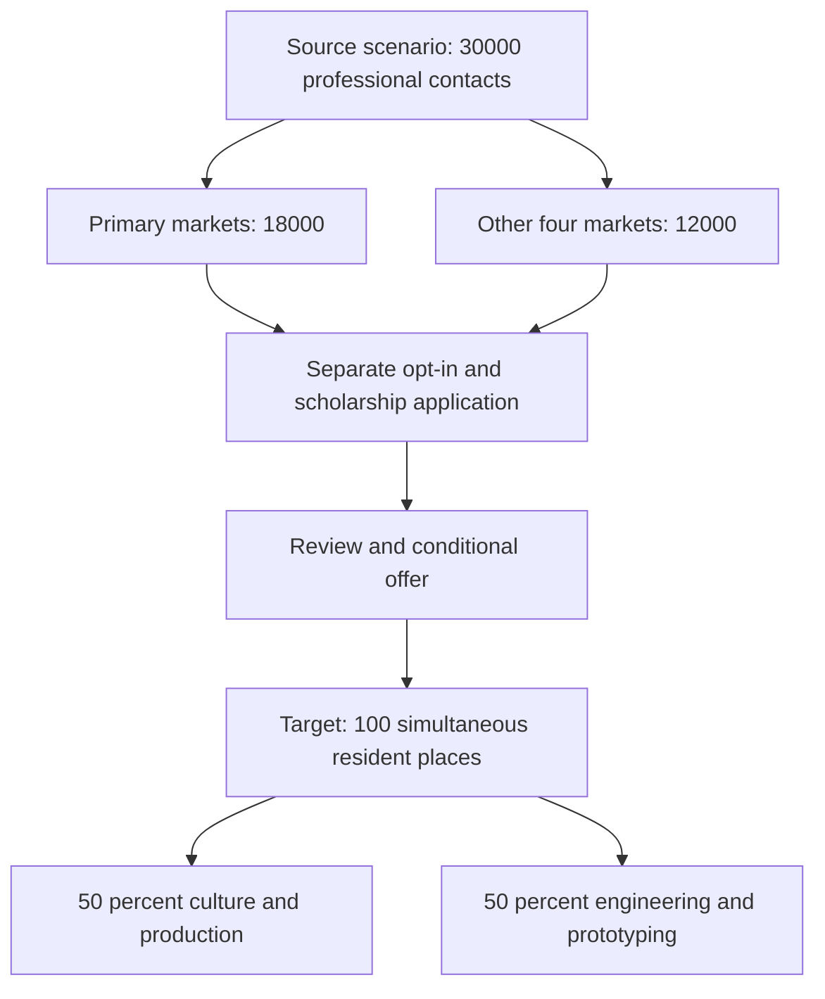

# Barranco residential training hub: operating model and scholarship scenarios

**Reviewed:** 12 October 2026  
**Status:** translated planning scenario; facility, funding, recruitment and engineering outcomes unverified.  
**Original:** [1 Modelo Operativo del.txt](https://github.com/robotics-intelligent-systems/jfxai4mad/blob/9ccb70e2096d0a62aef6991fdfcf88192606b923/docs/1%20Modelo%20Operativo%20del.txt)  
**Source baseline:** `9ccb70e2096d0a62aef6991fdfcf88192606b923`; **Git blob:** `a5b4cd0071ad15904ac667c17a8eaa58510e1f47`.

## 1. Translated operating model: lodging and experiential training

The draft proposes a small mansion, inspired by the historical house it calls “El Buen Viajero” in Barranco, Lima, as an urban regeneration and open-innovation hub. It combines high-quality shared accommodation, full agroecological meals sourced from the ecosystem's agricultural circuits, and practical learning laboratories for open hardware, floating robotics and composites.

The property reference is an inspiration in the source, not an identified available building, partner or verified historical attribution. No property, approved accommodation capacity, supply contract or training laboratory is established.

The proposed flow uses a 30,000-contact LinkedIn universe, two market blocks and a scholarship funnel toward 100 simultaneous women residents. It allocates half the activity to culture/production—ecotourism management, conscious eating and agricultural logistics—and half to engineering/prototyping—3D printing, open hardware, ROS 2/Gazebo digital twins and air–sea logistics.

The flow is a proposal, not a implemented contact database, recruitment campaign or capacity model. “50%” needs a declared denominator—participant allocation, hours or budget—before use.

### Source contact allocation

| Source block | Country | Contacts | Share of all 30,000 |
| --- | --- | ---: | ---: |
| Primary, 60% | India | 10,800 | 36% |
| Primary, 60% | Brazil | 7,200 | 24% |
| Other four markets, 40% | Mexico | 3,600 | 12% |
| Other four markets, 40% | Philippines | 3,600 | 12% |
| Other four markets, 40% | Türkiye | 2,400 | 8% |
| Other four markets, 40% | Colombia | 2,400 | 8% |
| Total | Six proposed markets | 30,000 | 100% |

The draft labels the second block “Next Eleven.” That label is retained as source terminology; the note does not verify membership in a formal economic classification.

## 2. Translated recruitment funnel and occupancy arithmetic

The source proposes excluding North America and China to shield the project from geopolitical instability. This is an unsupported strategy assertion: exclusions do not establish stability or lower risk. The source describes engineering, agronomy, tourism and applied-science profiles and links initial interactions to travel platforms and LinkedIn.

| Stage | Source rate | Source volume | Source operational description |
| --- | --- | ---: | --- |
| Target universe | 100% | 30,000 contacts | Engineering, agronomy, tourism and applied science. |
| Connections / initial interest | 15% | 4,500 applicants | Initial interaction through travel platforms and LinkedIn. |
| Interviews / scholarship filter | 10% of responses | 450 selected | Ethical/project alignment and languages. |
| Accepted scholarship | 66% of eligible candidates | 300 per year | Four-month residential commitment. |
| Simultaneous capacity | 33% of annual total | 100 active residents | Shared rooms and full scholarships. |

These labels are not interchangeable: a professional connection is not an applicant, a response is not eligibility, and an offer is not an arrival. Each stage needs an explicit cohort and denominator.

### Corrected calculation

- 30,000 × 15% = **4,500**; 4,500 × 10% = **450**.
- 450 × 66% = **297**, not 300. Obtaining 300 from 450 requires **66⅔%** acceptance.
- 300 × 33% = **99**, not 100. The steady-state occupancy fraction for a four-month stay is **4/12 = 33⅓%**.
- With 297 arrivals/year and exactly four-month stays, average occupancy is **297 × 4/12 = 99**.
- The capacity target of 100 beds requires **300 arrivals/year** at four months per stay, assuming full-year steady state, no vacancy gaps and no early departures.
- At the source's broader three-to-six-month range, 100 fully occupied beds correspond to **400 to 200 arrivals/year** respectively.
- If arrivals remain 300/year, six-month stays imply demand for **150 beds**; three-month stays imply **75** average occupants.

Bed capacity is an input to the occupancy model, not a conversion stage. The one-time stock of 30,000 contacts does not establish a repeatable annual acquisition cohort. Monthly arrival timing, renewal, cancellations, eligibility, vacancies and scholarship funding must be modeled separately. These values are scenario arithmetic, not forecasts.

## 3. Translated geographic residence allocation

| Source block | Country | Places / share of 100 | Skills or activities proposed by the source |
| --- | --- | ---: | --- |
| Primary, 60 places | India | 35 / 35% | Software, MLOps, ROS 2/Gazebo simulation and data engineering. |
| Primary, 60 places | Brazil | 25 / 25% | Agrotech, bioconstruction, marine logistics and composites. |
| Other markets, 40 places | Mexico | 12 / 12% | Additive manufacturing, open electronics and industrial design. |
| Other markets, 40 places | Philippines | 10 / 10% | Ecotourism hospitality, BPO support and global communication. |
| Other markets, 40 places | Türkiye | 10 / 10% | Naval engineering, modular robotics and floating mechatronics. |
| Other markets, 40 places | Colombia | 8 / 8% | Agroecology, impact-project management and circular economy. |

All six allocations sum to 100. They differ from the contact shares in section 1: India 36% versus 35%, Brazil 24% versus 25%, Philippines 12% versus 10%, Türkiye 8% versus 10%. A uniform conversion rate across markets does not produce both distributions. The source supplies no market-specific rates or capacity-selection rule.

The source's aim is cultural diversity and technology transfer; those outcomes are not guaranteed. Country/skill pairings are planning suggestions, not evidence of individual competence or national traits. A future program needs transparent individual qualification criteria and a review of its eligibility rules. The source's women-focused scholarship model is a proposal, not an established selection policy.

## 4. Translated costs and proposed value

The source assumes **USD 350–450 per resident-month** for shared accommodation and direct agricultural meals, and **USD 420,000–540,000 annually** for 100 residents.

The annual multiplication is correct: 100 × 12 × USD 350–450. It is a **lodging/meals scenario**, not a complete project budget. For a four-month scholarship the same assumption gives **USD 1,400–1,800 per participant**; 300 such scholarships equal 1,200 resident-months. The exact 297-person funnel equals 1,188 resident-months, costing **USD 415,800–534,600** under the same narrow assumption.

No quotes or comparable payroll baseline are supplied. Include separate assumptions for property rent/acquisition, utilities, upkeep, staff and instructors, laboratories/equipment, consumables, insurance, transport, administration and vacancies before claiming a full scholarship cost or payroll advantage.

### All three source value claims

1. Continuous operation of floating microfactories and validation of open hardware.
2. Machine testing along seasonal tourism instruction circuits.
3. A 70% reduction in research-and-development costs compared with traditional corporate hiring.

All remain unverified. Accommodation and student participation do not establish qualifications, safe operation or engineering acceptance. Learning, supervised observations, prototype testing, hardware verification and certification are different outputs. The 70% claim requires a matched scope, quality, time and complete-cost comparison; no such evidence is provided. Scholarship participants are not presumed substitutes for qualified employees.

## 5. Selected primary-source checks and unresolved questions

Checked on 12 October 2026:

- [LinkedIn invitation restrictions](https://www.linkedin.com/help/linkedin/answer/a551012/invitation-restrictions) describes restrictions and recommends relevant invitations; it does not authorize an automated recruitment funnel or confirm a 30,000-contact capacity.
- [LinkedIn User Agreement](https://www.linkedin.com/legal/user-agreement) establishes platform obligations including applicable privacy/anti-spam rules. The source scenario is not permission to scrape profiles or treat connections as consenting applicants.
- [Barranco municipal operating-license information](https://www.gob.pe/institucion/munibarranco/informes-publicaciones/4854151-licencias-de-funcionamiento-para-establecimientos-comerciales) describes the municipal authorization for economic activity in a particular establishment.
- [Barranco license and building-safety procedure](https://munibarranco.gob.pe/portal/licencia-de-funcionamiento-para-locales/) identifies procedure and safety requirements. This does not approve any particular residence, laboratory, occupancy or property in this proposal.

Building availability, permitted uses/occupancy, scholarship financing, participant travel/immigration status, insurance, labor/education arrangements and workshop approvals remain unresolved. This migration does not make eligibility or legal determinations for any individual.

## 6. Proposed next documentation task

Prepare a bounded feasibility register for an identified facility: approved capacity, room/teaching layout, cost quotations, learning objectives, qualified supervision, voluntary terms and a monthly cohort/bed model. Define ethical/project alignment as published, objective criteria; do not infer intimate traits or seek romantic participation from professional profiles. No outreach is performed by this task.

## Related material

- [TravelGirls and Worldpackers collaboration proposal](travelgirls-worldpackers-volunteer-collaboration.md)
- [Student volunteer and SME open-source adoption](student-volunteer-sme-open-source-adoption.md)
- [LinkedIn acquisition and lead velocity](../business/linkedin-contact-acquisition-and-lead-velocity.md)
- [Regional hiring hubs and market distribution](../business/regional-hiring-hubs-and-market-distribution.md)
- [Requirements and consent model](../product/requirements-and-consent.md)
- [Documentation index](../README.md)
- [Consolidated annex](../ANNEX-DOCS-CONSOLIDATED.md)

Coverage includes all four numbered sections, both contact blocks, all six country/contact and residence allocations, five funnel rows, both 50% activity branches and all three value claims. The original TXT remains recoverable through its immutable source link and Git history. No residence, scholarship, platform integration, model fit or engineering operation is implemented.
