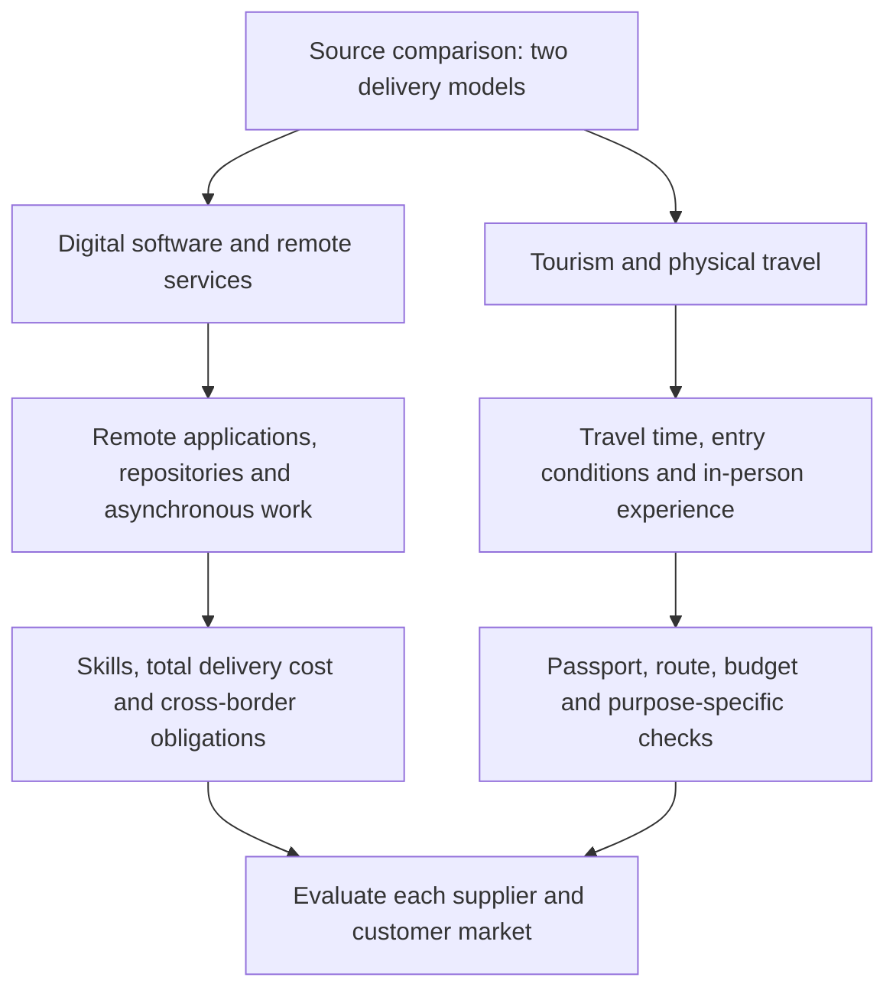

# Digital Software and Tourism Market Asymmetry

English translation and consolidation of `Este planteamiento expone.txt`. **Status:** exploratory strategic analysis, with selected primary-source checks dated 2026-10-13. The source contrasts remotely delivered software with tourism that requires physical travel. Regional dominance, cost advantages and spending concentration are source hypotheses, not established findings.

## 1. Dual markets: digital delivery and physical presence

The source describes an asymmetry between intangible trade (software and digital services) and tourism/human mobility. Its labels "Indo-European" (illustrated by the Indian subcontinent and Eastern Europe) and "Euro-American" (Europe and the Americas) are informal groupings, not defined economic blocs or uniform legal regimes.

The original flow associates digital firms with no physical borders, FOSS/remote delivery, low cost and scale; tourism with proximity, trade agreements/visa exemptions and on-site experiences. This distinction concerns delivery mechanics. Neither branch demonstrates unrestricted market access, uniform costs or a regional advantage.

## 2. Software: remote delivery and proposed cost arbitrage

**Asynchronous applications.** Public GitHub/GitLab repositories, remote technical assessments and asynchronous communication can support international recruitment without relocating every contributor. The source argues that developers in the Indian subcontinent or Eastern Europe can compete globally. This is a proposed mechanism; equal access and equal competitiveness require evidence about skills, connectivity, language, time zones and customer requirements.

**Entry costs and FOSS.** The source claims zero licensing cost lets firms spend only on talent. GNU defines free software through user freedoms, rather than price, and permits commercial distribution. FOSS adoption therefore does not establish zero purchase cost or zero total operating cost. Hosting, integration, maintenance, security, support and license compliance must be budgeted. [GNU: What is Free Software?](https://www.gnu.org/philosophy/free-sw.en.html)

**Labor-cost arbitrage.** The source proposes outsourcing to lower-cost regions to improve margins because code can travel without moving its author. This is a hypothesis about total delivery cost, not evidence of universal savings. Compare loaded labor cost, coordination, quality, rework and delivery risk for a defined project.

The source's "almost no regulatory barriers" and "no customs or migration procedures" claims are too broad. Remote delivery can avoid a contributor's travel, but does not remove applicable contracting, tax, intellectual-property, data or payment obligations. WTO material identifies regulation as relevant to digital services and digital intellectual property; country-specific applicability remains unresolved here. [WTO: Digital technologies and trade](https://www.wto.org/english/tratop_e/dtt_e/dtt_e.htm)

## 3. Tourism: geography and access conditions

**Visas and passports.** The source argues that Schengen arrangements, the U.S. Visa Waiver Program (VWP) and diplomatic relationships reduce travel friction, allowing immediate departure. These examples cannot support unrestricted mobility across Europe and the Americas. Schengen short-stay access depends on nationality and entry conditions; internal movement and permission to cross an external border are distinct. [Council of the EU: EU visa policy](https://www.consilium.europa.eu/en/policies/eu-visa-policy/)

The VWP applies to eligible travelers under specified conditions, including ESTA authorization. Approved ESTA permits travel to request admission and does not guarantee entry. It does not establish permission to work, reside or travel on any purpose. The source's "decide and travel within hours" statement is not a reliable planning rule. [U.S. Department of State: Visa Waiver Program](https://travel.state.gov/content/travel/en/us-visas/tourism-visit/visa-waiver-program.html)

**Trade agreements and open skies.** The source connects bilateral/free-trade agreements with direct flights, airline competition, consumer protection and unified payments. These are separate questions. U.S. DOT describes open-skies policy as reducing government involvement in airline route, capacity and pricing decisions; it does not promise a direct flight, cheap fare, visa exemption or unified payment system. Each additional outcome needs its own evidence. [U.S. DOT: Air Service Agreements](https://www.transportation.gov/policy/aviation-policy/international-relations/air-service-agreements)

**Geographic and cultural proximity.** The source contrasts software developed 10,000 km away with short vacations and business trips that prioritize flight duration and institutional/cultural familiarity. The distance is an illustration, not a measured corridor. Proximity may affect itinerary choice, but preferences differ by trip purpose, budget and destination. Claims of an "unattainable structural advantage" for a Euro-American axis remain unverified.

## 4. Barriers and incentives: qualified comparison

| Dimension | Digital software / remote services | Tourism / in-person services |
| --- | --- | --- |
| Product | Intangible software may be stored/copied; ongoing digital services also require delivery capacity. | An experience consumed at a location and time, supported by physical transport and accommodation. |
| Regulatory barriers | The source calls them almost absent for freelance/B2B work; applicable cross-border obligations still need assessment. | Entry, immigration and aviation conditions vary by nationality, route and purpose; not uniformly high. |
| Selection factors | Source priorities: technical competence, cost and agility; evaluate reliability, security and complete delivery cost too. | Source priorities: proximity, access and legal predictability; test alongside attractions, price and traveler preferences. |
| Agreements | The source calls their role secondary; digital-service access and regulatory provisions can still matter. | The source calls them decisive; air-service access, visa policy, currency/payment access and trade agreements must be assessed separately. |

This table preserves all four original comparison dimensions without turning broad regional assertions into benchmarks.

## 5. Strategic implications and project evaluation

**Regional specialization.** The source portrays the Indo-European grouping as a global technology back office/code factory and high-spending tourism as concentrated in Euro-American corridors. No spending dataset, regional membership, time period or comparative outsourcing evidence is supplied. These are proposed patterns, not forced specializations or verified global rankings.

**Access as a competitive advantage.** The source calls visa exemptions and commercial agreements a geopolitical "moat." Access friction is a useful variable to test, but this metaphor does not establish where tourism capital is concentrated or exclude competitive destinations elsewhere.

**Emerging-market opportunity.** The source proposes combining tourism promotion with corporate/migration diplomacy, digital-nomad visas, easier entry and open-skies agreements. These are policy options for evaluation, not permissions already granted or measures the project can implement unilaterally. Remote-work, tourist and residence eligibility must remain separate.

For jfxai4mad, connect this comparison to the [regional hiring scenario](../business/regional-hiring-hubs-and-market-distribution.md), [Italy corridor proposal](italy-logistics-cultural-node-turkiye-argentina.md) and [tourism origin-market research](../research/tourism/inbound-origin-market-research.md). They describe different populations and activities; their contact, customer and traveler counts cannot be combined as one conversion funnel.

**Next task: MAD-ASYM-001.** Prepare a dated evidence matrix for explicitly named supplier/customer countries and traveler origin/destination pairs. Record remote-project scope, complete delivery costs, regulatory applicability, trip purpose, nationality, entry requirements, route availability, door-to-door time, total trip cost and tourism spending evidence. Compare matched cases before ranking markets or claiming savings, dominance or higher conversion. No hiring, policy negotiation, outreach, booking or travel is performed by this note.

## Source and coverage

[Immutable Spanish original](https://github.com/robotics-intelligent-systems/jfxai4mad/blob/ce5c79cebb0b7d1945cd4a34c9c9f28e32b6d28c/docs/Este%20planteamiento%20expone.txt).

Baseline commit: `ce5c79cebb0b7d1945cd4a34c9c9f28e32b6d28c`; original Git blob: `c6a02c08f359a8ae90fa7471e39cbb0797b8b987`.

Coverage: introduction, all five numbered sections, both original diagram branches, three software mechanisms, three tourism mechanisms, all four comparison rows and all three strategic conclusions. Qualifications, source checks, project links and the evidence-matrix task are editorial additions. The working TXT is replaced by English Markdown; Git history preserves the original.
