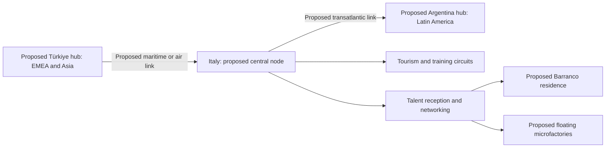

# Italy as a Logistics and Cultural Node: Türkiye–Argentina Axis

[Documentation index](../README.md) · [Strategy index](README.md)

## Purpose and status

The source proposes Italy as a Mediterranean logistics and cultural bridge between an Indo-EMEA hub in Türkiye and a Latin American hub in Argentina. It also proposes an intermediate reception and networking location for international talent travelling toward the Barranco residence or floating microfactories.

This is a strategic concept. The source's description of a “perfect” bridge is an aspiration, not a comparative route study. No operating hub, treaty, partnership, shipment, scholarship placement or pilot is established by this note.

## 1. Geopolitical and logistics bridge

The original “Axis–Node Treaty” heading is retained here as a proposed coordination framework; the source identifies no signed treaty, parties or legal instrument.

### Air and maritime connectivity

The source names Trieste and Genoa ports and Milan and Rome airports as candidate convergence points for Turkish trade before onward movement to Argentina. It proposes moving open-hardware components, mechatronic prototypes and composite materials developed by the Turkish team for testing or integration in Latin American circuits.

A selected operator check supports a Türkiye–Italy freight link: [DFDS describes its Pendik–Trieste route](https://www.dfds.com.tr/pendik-trieste/en/666). The [Ports of Genoa 2024 trade publication](https://www.portsofgenoa.com/documenti/pubblicazioni/The_Southern_Gateway_to_Europe_for_fresh_trade_-_Fruit_Logistica_2024.pdf) lists Latin American shipping services. These sources support considering Italy as a candidate node; they do not prove a single through-service to Argentina, an optimal itinerary or current end-to-end cost.

Do not assume all Turkish cargo must pass through the Bosporus or Italy. Trieste and Genoa are separate ports; any transfer between them adds a leg. Milan/Rome passenger access and specialist cargo handling require separate checks. Compare direct Türkiye–Argentina options with Italian transshipment for each cargo class.

### Mobility for scholarship recipients and volunteers

The source invokes Italy's academic and cultural cooperation with Latin America and the eastern Mediterranean and proposes a stopover for pre-incubation, networking and preparation before final placement at operational hubs. Its references to women volunteers and scholarship recipients describe the source's proposed cohort; eligibility and selection rules remain undefined.

“Free zone” is a metaphor for this preparation stage. It does not establish an immigration, employment or customs exemption. The [Italian foreign ministry's visa portal](https://vistoperitalia.esteri.it/) determines requirements using nationality, residence, duration and purpose. Its [study guidance](https://www.esteri.it/en/ministero/sportello_info/domandefrequenti/studiare-in-italia/) describes study-specific procedures; a project invitation alone does not demonstrate eligibility for study or other activities.

No named academic partner, exchange agreement or scholarship funding is supplied. Establish the activity, host, eligibility, accommodation, funding and applicable entry conditions before treating the stopover as available.

## 2. Experiential ecotourism and seasonal circuits

### Historical and cultural test environment

The source identifies Sicily and Apulia as candidates whose climate, agriculture and tourism may resemble seasonal agricultural test circuits. It proposes testing cloud management systems and consignment-store models in areas receiving international visitors, before considering deployment in Latin America and India.

Similarity is an untested selection hypothesis. Define crop or activity, season, visitor mix, connectivity, language, operating cost and user tasks for each pilot. Results from one Italian site cannot alone establish suitability for different markets.

### Open-engineering knowledge exchange

The source proposes drawing on Italian industrial design and advanced manufacturing networks to connect GitHub-based open-source automation with the needs of SMEs in the Global South. This is a collaboration objective; no manufacturer, design institution or SME has committed to participate.

Possible deliverables are reusable design documentation, prototype reviews and an evaluated cloud/consignment workflow. Record licenses, owners, local adaptations and measured outcomes before claiming technology transfer or business benefit.

## Proposed evaluation and next task

| Workstream | Evidence needed before selection |
| --- | --- |
| Cargo corridor | Origin/destination, dimensions and cargo classification; direct and via-Italy quotes; handling, insurance, customs and total transit time |
| Talent stopover | Named host and programme; eligible activities, entry/residence requirements, funding and onward itinerary |
| Seasonal pilot | Named Sicily/Apulia site; season and baseline; representative cloud and consignment tasks |
| Engineering exchange | Interested partners, license terms, responsibilities and agreed prototype/SME outputs |

The next AI-assisted task is to build a comparison matrix for direct Türkiye–Argentina logistics versus an Italian node, using one representative shipment and one independently assessed adult participant itinerary. Keep freight economics, participant mobility and pilot performance as separate decisions.

Related proposals: [regional hiring hubs](../business/regional-hiring-hubs-and-market-distribution.md), [Barranco training hub](barranco-residential-training-hub-operating-model.md), [value architecture and logistics](../business/value-architecture-and-financing.md) and [territorial tourism development](multisector-territorial-tourism-development-flow.md).

## Source and coverage

[Immutable original: Italia como Nodo Logístico.txt](https://github.com/robotics-intelligent-systems/jfxai4mad/blob/fd30992ed3476b270fe8c04674bd7433a4a951b7/docs/Italia%20como%20Nodo%20Log%C3%ADstico.txt).

Baseline commit: `fd30992ed3476b270fe8c04674bd7433a4a951b7`; Git blob: `c6140f2110735083c504c0a026cb531d1a01173d`.

Coverage includes the opening bridge/reception premise, both original numbered sections, the Türkiye–Italy–Argentina flow and training branch, all named transport nodes, hardware/prototype/material transfer, volunteer/scholarship mobility, Sicily/Apulia testing, cloud and consignment pilots, Latin America/India rollout and open-engineering/SME exchange. Selected primary-source checks were reviewed on 12 October 2026. Qualifications and evaluation steps are editorial additions. English Markdown replaces the working TXT; Git history preserves the original.
