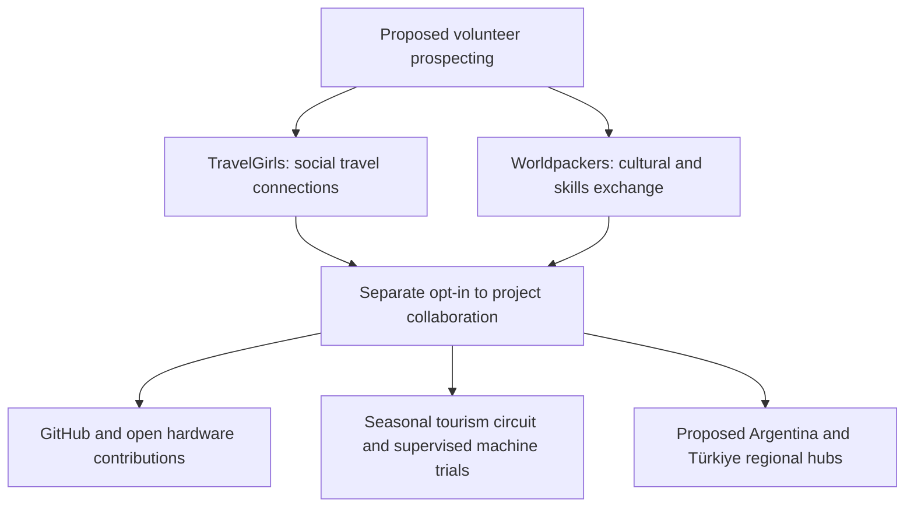

# TravelGirls and Worldpackers: proposed volunteer collaboration channels

**Reviewed:** 12 October 2026  
**Status:** translated planning proposal; no integration or recruitment pilot implemented.  
**Original:** [Integración de TravelGirls.txt](https://github.com/robotics-intelligent-systems/jfxai4mad/blob/2c107eef04c3a03d3139575fa82d3a129a80e0ec/docs/Integraci%C3%B3n%20de%20TravelGirls.txt)  
**Baseline commit:** `2c107eef04c3a03d3139575fa82d3a129a80e0ec`  
**Original Git blob:** `0d127101279fc1ad08fb400e77fc78629794bd95`

## Source premise and proposed flow

The source proposes a prospecting and recruitment network for women volunteers through travel, collaboration and cultural exchange instead of conventional commercial dating platforms. It names Tinder, Bumble and Hinge as Match Group examples; **Bumble belongs to Bumble Inc., not Match Group**. The source's characterization of dating platforms as exclusively casual, commercialized or unproductive is an opinion, not a demonstrated comparison.

The translated flow retains both channels and all three proposed ecosystem destinations. Arrows describe voluntary participation hypotheses, not an API integration, platform partnership or working acquisition funnel.

## 1. Translated strategic roles

### Worldpackers: functional contribution and learning

**Source function:** attract women interested in sustainability, technology and community tourism.

**Source mechanism:** offer stays and exchanges along seasonal tourism instruction circuits; participants would help test and certify open machines and hardware in return for accommodation, skill development and agricultural or technology project experience.

**Qualification:** Worldpackers describes skills-for-accommodation exchange, not an employment service. Availability of technical volunteers, suitability of these projects and approval of any host remain unverified. The proposed machine certification is not established by participation: trial observations, engineering validation and formal conformity assessment are distinct activities. Any eventual machine work needs qualified supervision, an approved test plan and evidence criteria. No certification authority or validated machine is identified.

### TravelGirls: networking and social travel connections

**Source function:** a global network connecting independent women travelers.

**Source mechanism:** an alternative communication and in-person meeting channel for Latin American and Indo-EMEA hubs, facilitating team and community integration outside conventional dating-app dynamics.

**Qualification:** the official site returned a JavaScript-only shell in this review. Recruitment permissions, audience composition, pricing, messaging restrictions and integration/API capabilities were not verified. A travel or social profile does not establish willingness to volunteer, professional skills or consent to recruitment. Any project invitation would require an explicit, separate opt-in and compliance with platform terms.

## 2. Translated comparison and evidence limits

| Criterion | Dating-app model: source claim | Worldpackers + TravelGirls: source claim | Review |
| --- | --- | --- | --- |
| User intention | Entertainment and casual relationships | Collaboration, travel, learning and exchange | Motives vary; Worldpackers describes cultural/skills exchange, but no comparable user survey supports the dichotomy. |
| Project alignment | Low; algorithms focus on retention | High; direct interest in travel and projects | Hypothesis requiring a defined contribution cohort and observed outcomes. |
| Acquisition cost | High; advertising/premium subscriptions | Low; freemium or accommodation for work | No cost study supplied. Traveler membership and accommodation, food, staff, insurance and supervision costs must be considered. |
| Ecosystem contribution | None | Direct GitHub integration and machine validation | Unsupported absolute claims; no GitHub connector, measured contribution or machine-validation evidence is supplied. |

Measure cost per consenting qualified participant and per accepted contribution rather than equating profile contacts, stays, volunteer interest and validated engineering output.

## 3. Selected primary-source checks

Checked on 12 October 2026:

- [Worldpackers: how it works](https://help.worldpackers.com/en/hc/how-does-worldpackers-work) describes cultural exchange and skills offered for accommodation, including social and ecological projects. This supports the general exchange model, not technical recruiting or certification.
- [Worldpackers: host questions](https://help.worldpackers.com/en/hc/initial-questions-about-being-a-worldpackers-host) states that hosts use the service free, travelers need a paid membership to apply/confirm trips, and paid positions are outside its model. Some projects may charge disclosed accommodation/food fees. It directs hosts to local authorities for restrictions on volunteering; platform descriptions do not establish immigration or labor-law eligibility.
- [Bumble Inc.: corporate overview](https://ir.bumble.com/overview/default.aspx) identifies Bumble, Badoo and BFF under Bumble Inc.
- [Match Group: annual filing](https://www.sec.gov/Archives/edgar/data/891103/000089110325000027/mtch-20241231.htm) identifies Tinder and Hinge among its brands.
- [TravelGirls official site](https://www.travelgirls.com/) was accessed, but substantive service terms could not be retrieved without JavaScript. Its recruiting suitability remains unresolved.

No platform price, conversion rate, legal eligibility or partnership is assumed.

## 4. Proposed next project task

Prepare a human-reviewed collaboration brief defining activities, skills, learning outcomes, hours, lodging, disclosed fees, supervision, exit arrangements and contribution licensing. Review current platform terms and local requirements for the actual host and route before considering a pilot.

Participation in professional collaboration must be voluntary and independent of romantic or intimate involvement. The source focuses on women; eligibility for a future technical role needs documented skills-based criteria and a review of applicable equal-treatment rules. No candidate data, invitations or platform accounts are created by this documentation task.

For any pilot, distinguish interested adults, separately opted-in applicants, suitable participants, completed exchanges, accepted GitHub contributions and supervised trial evidence. Formal certification requires its own applicable procedure.

## Related documentation

- [Student volunteer and SME open-source adoption](./student-volunteer-sme-open-source-adoption.md)
- [Regional hiring hubs and market distribution](../business/regional-hiring-hubs-and-market-distribution.md)
- [Match Group and peer marriage-conversion research](../research/platforms/match-group-and-peer-marriage-conversion.md)
- [Requirements and consent model](../product/requirements-and-consent.md)
- [Strategy index](./README.md)
- [Documentation index](../README.md)
- [Consolidated annex](../ANNEX-DOCS-CONSOLIDATED.md)

Coverage includes the opening premise, both branches of the original plaintext flow, all three ecosystem destinations, both platform-role sections and all four comparison rows. The original TXT is preserved through the immutable source link and Git history after replacement.
